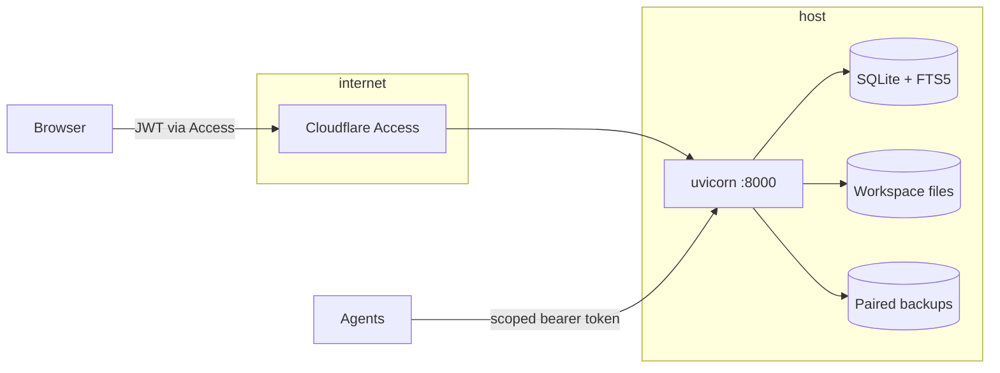

# Sangam architecture

Sangam is a single-user, self-hosted document server for humans and AI agents.
One human owner and any number of scoped agents work on ordinary files through
the same revision-aware API. Document edits carry an actor identity, an idempotency key, and an expected
revision or an HTTP precondition.

Chat proposes edits to existing documents. Review mode leaves them pending for
human review. YOLO mode attempts to apply chat proposals and runs supported
effects without approval prompts, subject to the same authorization and revision
checks. Scoped API tokens can write directly within their grants.

## Core concepts

- **Document:** The unit of identity. A document has a path (e.g.,
  `research/notes.md`), a content type (`text/markdown`, `text/html`, or
  `application/pdf`), tags and a category, and an immutable revision chain.
- **Revision:** Every save creates a new immutable revision. Diffs, restores,
  citations, and publications point at exact revisions, so those references remain stable.
- **Workspace:** A plain directory tree on disk that mirrors the SQLite
  database. SQLite is the canonical store. Files are materialized on disk for
  portability, grep, and external editors.
- **Reconciliation:** A service that compares SQLite against materialized files
  on disk and reports drift. Conflicts appear in the UI for explicit resolution
  and are never silently overwritten.
- **Publication:** A single pinned revision exposed at a stable custom slug as
  private, unlisted, or public.
- **Actor:** An identity string such as `human:jay` or `agent:researcher`.
  Every change is attributed to an actor.
- **Operation:** One call through `WorkspaceAccessService.audited`. Each
  operation declares its ledger name and whether it reads or writes (`reads(...)`
  or `writes(...)` in `src/sangam/access.py`).

## Write path

Workspace actions share an access and audit boundary. Document writes use a
common commit path.

1. **Access and audit (`WorkspaceAccessService.audited`).** Every write records
   exactly one activity-ledger row, either inside the first transaction it
   commits or after it returns if nothing committed. Denials, conflicts, and
   failures are recorded as well. Reads are recorded only for non-human
   principals. HTTP routes, chat, organization plans, projects, saved views,
   Karakeep imports, backups, tokens, and settings all enter here. Administrator
   checks also record a denial before any operation runs.
2. **Document writes (`WorkspaceAccessService.write_document`).** Update,
   duplicate, tag, materialize, move, delete, restore, and trust changes all
   share this path with the same request models. It authorizes fresh source and
   destination paths, requires an expected revision unless HTTP `If-Match` or
   `If-None-Match` preconditions are supplied, and records the diff.
3. **Commit pipeline (`DocumentService._commit`).** Inside the committing
   transaction, the pipeline checks the actor, replays any reused idempotency
   key, rechecks the expected revision, writes the revision, binds the key, and
   records the ledger target. Because PDF bytes live only on disk, a PDF move,
   trash, or restore applies the file step first and undoes it if the database
   commit fails. After the commit succeeds, the pipeline materializes text
   files, removes stale files, and updates search indexes. A failed text
   materialization can leave a committed revision with a pending file write.
   An identical retry or reconciliation can finish that write.
4. **Idempotency (`IdempotencyStore`).** One store owns both idempotency tables.
   Other modules ask it whether a key committed rather than querying those
   tables directly.

Chat runs outlive the HTTP request that starts them. Before every chat tool call
and effect decision, the server refreshes the run principal's current token
grants. A token revoked mid-run cannot read, propose, or execute an effect,
even in YOLO mode.

## Trust model

Sangam runs for one owner. Everything inside the workspace belongs to one
administrator. Three authentication modes cover local development through public
HTTPS deployment.

| Mode | How requests authenticate | Typical use |
| --- | --- | --- |
| `single_user` | No request authentication; loopback only | Local development |
| `trusted_proxy` | A reverse proxy injects a trusted identity header | Tailnet or private network |
| `cloudflare_access` | Per-request Cloudflare Access JWT check (team domain, audience, email) | Public HTTPS |

### HTML rendering zones

Sangam separates static document rendering from interactive JavaScript execution
into two zones:

- **Safe zone:** Workspace previews and published pages are sanitized with
  DOMPurify and rendered without script execution.
- **Trusted preview zone:** Interactive HTML and JavaScript execute under
  `/trusted-preview`, gated by a short-lived HMAC token signed with
  `SANGAM_PREVIEW_HMAC_SECRET`. Development permits a same-origin preview setup.
  Production requires an isolated HTTPS preview host separate from both the
  publication host and all parent origins, a non-default secret, and explicit
  parent origins. Optional `connect-src` allowances must use HTTPS or WSS.

Whether saved HTML revisions may execute JavaScript at all is controlled by a
versioned workspace setting (`GET/PUT /api/v1/settings/html-javascript`, enabled
by default). Every change is attributed and recorded in the activity ledger.
Disabling this setting makes trusted previews inert until it is re-enabled.

## Data and storage

SQLite is the canonical store for documents, revisions, FTS5 search indexes,
publications, projects, chat threads, and the activity ledger. Text documents
are also materialized to `SANGAM_WORKSPACE_ROOT` atomically (write to a
temporary file, then rename). Reconciliation repairs pending writes and
surfaces conflicts with external edits.

### Attachments

Images added to a document are stored once in the workspace's shared
`attachments/` directory as `<name>-<sha16>.<ext>` and referenced with a
root-relative path (`/attachments/...`). Moving a document or renaming a folder
cannot break image links, and pathless drafts can still hold images. Only PNG,
JPEG, GIF, and WebP are accepted. SVG uploads are rejected.

### Paired backups

Backups are paired artifacts written to `SANGAM_BACKUP_ROOT`. Each backup
contains a SQLite snapshot, a workspace archive from the same generation, and
a manifest. Sangam verifies sets when created and rotates them by count.
[Backups and recovery](operations/backups.md) describes freshness checks and
how to verify artifacts on demand.

## Search and saved views

Full-text search runs on SQLite FTS5 across documents, extracted PDF page text,
and PDF annotations. FTS ranks candidate documents first. Sangam then rescans
only the returned page to extract up to three located passages per result
(`search_matches`). A match can come from document text, a PDF page, an
annotation, a title, a path, or metadata. Results show highlighted snippets
with locations such as a heading and line or a PDF page when available. Selecting a result opens
the editor at that line or the PDF at that page.

SQLite triggers record changed document IDs in `search_dirty_documents` inside
the same transaction as searchable content changes. Index synchronization reads
canonical state and removes the dirty marker in one transaction. Startup repairs
only pending markers. The migration that introduces these markers seeds
existing documents for one initial rebuild. Explicit reindexing
remains available in Settings for maintenance. Any code change that alters
indexed fields must update the trigger coverage as well.

Saved views (`/api/v1/saved-views`) store named search queries and filter sets
on the server for the workspace owner so they follow the owner across devices.

## Agent access and activity

External agents never share the human's session. Each agent receives a bearer
token created in Settings or through `/api/v1/agent-tokens` with:

- **Capabilities:** Fine-grained scopes such as `read`, `search`, `create`,
  `update`, `move`, `tag`, `restore`, `delete`, `publish`, and `inference`.
- **Path boundaries:** Optional recursive prefix limits (e.g.,
  `projects/agent-x/`).
- **Expiry and rotation:** Independent expiration, rotation, and instant
  revocation.

For document edits, send the current revision ID or a document validator where
supported. On HTTP `409` or `412`, re-read before retrying the intended change.
See [conditional requests](operations/agent-access.md#etags-and-conditional-http-requests)
for the interaction between revision guards and idempotency keys.

`GET /api/v1/activity` returns bounded chronological pages with exact filters.
`GET /api/v1/activity/summary` computes bounded outcome, actor, document,
publication, problem, and token-health aggregates in SQLite so the UI never
estimates totals from a single page. `operation_id` is the only durable grouping
key and is not a session or run ID. The ledger does not currently auto-delete
old rows; adding retention requires an explicit migration and operating policy.

## Projects and persistent reviews

Projects group a Markdown purpose brief, references to existing documents by
role, collected PDF passages, attached chat conversations, and a saved workbench
layout. Deleting a project keeps its underlying documents and conversations. See
[projects.md](projects.md).

Persistent project reviews run as server-owned assignments over a bounded set of
selected project documents. They survive browser disconnects and server
restarts, support steering and pause/stop controls, and produce private
citation-checked findings documents or fresh proposal candidates. See
[project-assignments.md](project-assignments.md).

## PDF research

PDFs are imported immutably with SHA-256 tracking. Background workers extract
page text into FTS5, and pages are served over HTTP byte ranges. Annotations and
notes pin to exact pages with optimistic versioning. A replacement PDF is a new document linked to the prior PDF by
`supersedes_document_id` (`--supersedes` in the CLI). PDFs also participate in
workspace organization plans: they can be moved, renamed, duplicated (without
annotations), trashed with byte retention, and restored.

## Publishing

A publication pins one exact revision (`publications.revision_id`) at a custom
slug under `SANGAM_PUBLICATION_BASE_URL` with `private`, `unlisted`, or `public`
access. Saving a newer draft does not alter what readers see. The editor shows
when the saved draft differs from the published revision and links to their
diff. Advancing a publication requires an explicit
`PATCH /api/v1/publications/{id}` with the new `revision_id`. Older revisions
stay hidden unless explicitly exposed.

## Chat runtime and experimental MCP

Chat pairs the ChatKit UI with the OpenAI Agents SDK and a configured
OpenAI-compatible provider. Threads are durable and scoped to their owners.
Check the browser transport and provider configuration separately from
`/api/v1/readiness`.

Grounding tools search the workspace, read documents, inspect organization
metadata, and draft revision-pinned proposals. Organization plans and direct
explorer actions share one preflight and execution path behind
`WorkspaceAccessService`. Neither chat nor the browser writes SQLite or files
directly. Review mode pauses each durable effect for an exact decision. YOLO mode applies
chat proposals and executes effects, including publication, when actor, scope,
revision, and path checks pass. See [chat-capabilities.md](chat-capabilities.md)
and the [capability lifecycle diagram](assets/chat-capability-lifecycle.html)
for details, and [operations/integrations.md](operations/integrations.md) for
provider setup.

Sangam enables its experimental MCP server by default. The server exposes
restricted Python Code Mode (`search`, `execute`, `present`), a
sandboxed MCP App, centralized skills, and server-owned assistant requests over
the same canonical services and bearer token grants. See [mcp.md](mcp.md).

## Karakeep bridge

Archived Karakeep bookmarks can be imported selectively as editable Markdown.
Imports preserve provenance (original URL and capture time) and are idempotent.
Refreshing a bookmark surfaces a diff for review instead of overwriting local
edits.

## Recovery

Stop Sangam before restoring the SQLite snapshot and workspace archive from
the same backup set. Start Sangam, run reconciliation, and verify readiness. Database migrations are forward-only. Rolling back a
release means deploying the previous signed image digest together with a full
paired restore. See [operations/backups.md](operations/backups.md).

## Architecture Decision Records

Non-obvious implementation invariants and subsystem trade-offs live in
[docs/adr/README.md](adr/README.md) rather than inline code comments.
