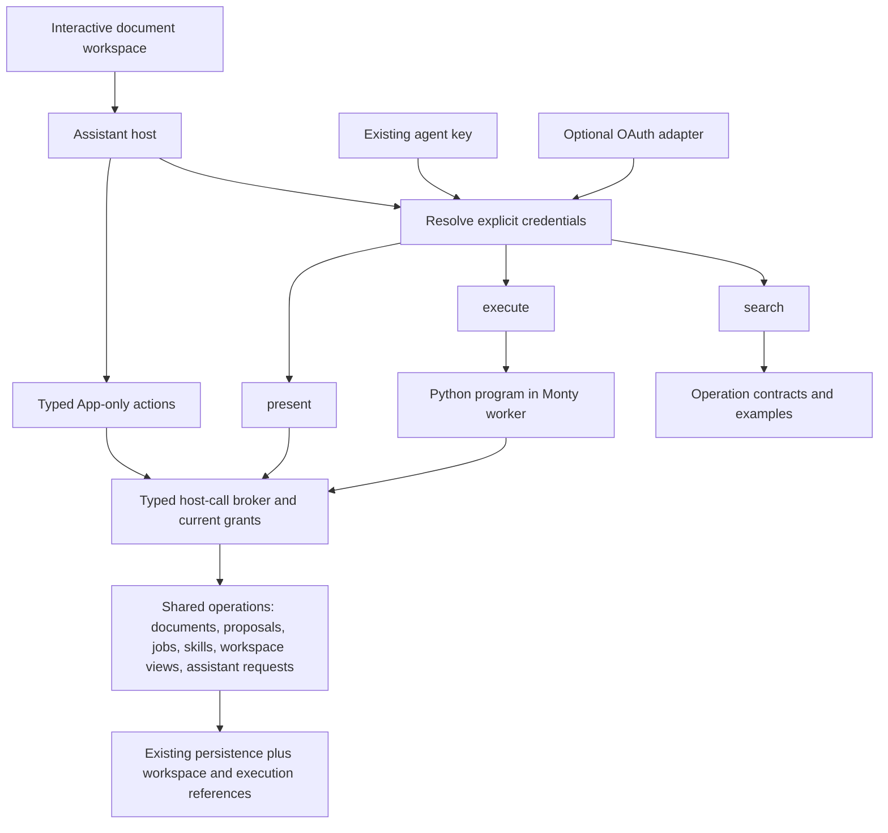

# Technical design: Sangam MCP experience

## Purpose and scope

This is the primary document for deciding what Sangam's MCP integration should
do. It consolidates user setup, authentication, workspace operations, documents,
centralized skills, interactive Apps, events, and long-running work. It describes
functional behavior and service boundaries, without implementation phases.

The [research report](01-research-november-2026.md) contains source evidence,
reference implementations, protocol maturity, and repository findings. Direct
MCP writes follow existing key permissions. Review is an explicit workflow;
this design adds no mandatory review mode or proposal-only permission.
Recommendations remain draft unless listed as agreed constraints.

The intended outcome is that an assistant connects once, discovers Sangam's
capabilities and instructions, and works within the same authority as an API
client. Optional protocol features improve interaction without becoming a
requirement for ordinary document work.

### Final system-design review

All 22 behavior decisions are settled. This document is ready for final
system-design review. It remains draft until that review is approved; exact
program design and implementation beyond the approved slice remain design
work. The remaining engineering work is consolidated below rather than
treated as another series of product-preference questions.

The system is one existing Sangam server with a public `/mcp` endpoint and
three model-visible tools: `search`, `execute`, and `present`. Search discovers
usable operation contracts. Execute runs a fresh restricted Python program in
a separate Monty worker and returns its selected output. Present opens the
interactive document workspace in compatible hosts. An App-only typed
dispatcher handles human interactions through the same authorized broker.

Existing API keys and grants govern every operation. Optional OAuth acquires
credentials bound to those grants. Saved documents use the existing revision
and idempotency paths. Failures preserve committed changes; jobs return
checkable references. Neither a Python result nor a notification guarantees
that the host starts another model turn.

The App supports search, multiple documents, PDF pages, permitted edits,
comparison, and saving. Draft checkpoints stay separate from saved revisions.
Clean current views refresh automatically; unsaved drafts and historical views
stay intact. Skills are centrally maintained, explicitly registered, and
exported as immutable revision-pinned bundles under current read authority.

Detailed execution results expire after a configurable seven days, while
compact duplicate protection and unresolved recovery evidence remain.
Superseded skill snapshots expire after a configurable seven days. Clean
workspace layouts expire after a configurable 30 days of inactivity.
Acknowledged unfinished drafts survive until Save or Discard.

The remaining four engineering groups are operation contracts, numeric limits
and quotas, OAuth implementation, and dependency/host compatibility. Their
required evidence appears under engineering work and verification below.
No runtime compatibility, capacity, or end-to-end MCP implementation is
claimed by this document review.

### Approved implementation slice

On November 15, the user approved Option 2 and requested a real end-to-end
implementation, a PR, a local walkthrough, and verification. The implemented
workflow is API-key connection, operation discovery, fresh Monty execution to
find Markdown documents, an editable MCP App, recoverable draft checkpoints,
and a revision-aware Save. The user subsequently selected search and multiple
open documents inside the App as the next implementation addition. It uses the
same server and existing permissions.
There is one execution tool and no additional write-approval mode.

The catalog contains `documents.search`, `documents.read`, `documents.update`,
and `executions.get`. The App-only dispatcher has typed search, open, activate,
close, refresh, checkpoint, save, and discard actions. The authenticated
`sangam://execution/{execution_key}` resource makes recovery available when
new execution admission is full. A local host uses the official MCP client
and AppBridge with an opaque sandboxed frame. It is a working test host,
not proof that every external host supports Apps or API-key connections.

Detailed execution results retain the agreed seven-day default. Unfinished
drafts survive until Save or Discard. Clean workspace layouts retain the
30-day default. The slice has bounded workers, inputs, outputs, callbacks,
workspace count, draft bytes, and execution receipt count. Its worker limits
are conservative defaults awaiting production capacity measurements.

The App now stores a versioned open-document layout with an active document and
separate draft checkpoints for each document. Migration `039` preserves existing
checkpoint IDs, drafts, and versions while assigning each legacy view a layout.
`present` accepts an initial document plus additional document IDs, or a layout
ID to restore the active view. A supplied document/checkpoint pair must match.
App search is a direct typed bridge action. Search results and tab metadata
recheck current grants. Closing a dirty tab requires Save or explicit Discard.
Navigation acknowledges the outgoing draft before changing documents and keeps
the editor read-only during the transition. The active reference and open tabs
survive reloading the host and reconnecting. One acknowledged draft protects the
entire layout from idle cleanup; closing a clean tab frees its checkpoint quota.

The public endpoint accepts both `/mcp` and `/mcp/` with built frontend assets.
Recovery authorizes retained source metadata even after a document is trashed.
Caught Python callback exceptions do not force failure of a completed program.
In-flight receipts explicitly mark output as unavailable and identify their
write evidence as incomplete. Cancellation retains write references and permits
later inspection of commits that finish after the client stops waiting.

The App displays one active Markdown editor. Split panes, persistent cursor
locations, PDF pages, binary upload, registered skills, OAuth issuance, native Tasks,
proposals, and assistant delegation remain broader design
scope. Their presence elsewhere in this document does not claim they are
implemented. [MCP setup and contracts](../../mcp.md) describe the current
slice and its reproducible verification commands.

On November 16, the user requested continued implementation in this order:
Apps and events, PDF support, centralized skills, then Sangam assistant requests
and the remaining workspace actions. This authorizes implementation beyond the
original minimal slice. The complete design is not yet implemented.

The first shared primitive is an authorized resource reference. Workspace,
document, and execution resources use the same reader for explicit reads and
native `subscriptions/listen` change observation. Streams carry URI invalidation
hints and close when current authority is lost. They have bounded subscriptions
and buffers. Current state is observed once per second, so writes through the
normal UI and REST participate without a separate MCP write path or event log.
The App consumes fresh snapshots through its standard bridge and uses the same
merge rules as polling. It preserves local drafts and explicit conflict actions.
PDF status, skill snapshots, and assistant jobs should reuse this reference/read/
observe pattern as those operations are added. Typed operations remain the action
primitive behind the compact public tools.

MCP is an external entry point to selected authorized Sangam workflows. The
compact tools are the access mechanism; the useful result is working with
documents, skills, and the shared workspace. Invoking Sangam's own AI follows
Decision 11. Conversation continuation and result reads use explicit owned
references under Decision 12; broad history/profile export is outside scope.

## Agreed constraints

- Use the shared MCP standard and capability negotiation. No host defines the
  core behavior.
- Reuse Sangam's existing agent identity, API keys, capability grants, path
  scopes, expiry, and revocation.
- API keys remain the user's current connection method. If OAuth is configured,
  use the approved owner or scoped-key delegation paths in Decision 5, bound
  to existing grants. OAuth is not a prerequisite for API-key connections.
- An authorized API operation has the same meaning through MCP. MCP does not
  add a separate permission mode or mandatory review rule.
- Maintain instructions centrally and make them available through the MCP
  connection where clients support discovery and loading.
- Let a connection discover explicitly registered skills whose underlying
  documents it can currently read, regardless of who registered them. Check
  supporting files separately. Do not add another MCP sharing permission.
- Export skills as revision-pinned bundles with explicit supporting-file paths.
  Keep logical registration identity separate from immutable export versions.
  Included-file changes produce a new snapshot; old exports never substitute
  current bytes. Reuse existing revision storage for content.
- Keep current skill snapshots available while registered and their sources
  remain available. Retain superseded snapshots for a configurable seven days
  after replacement. Report expiry explicitly without deleting source revisions
  or relaxing current permissions.
- Study advanced patterns, including Apps, Tasks, subscriptions, and Code Mode.
  Distinguish working functionality from experiments and proposals.
- Use Option B: discover operations on demand and compose calls in a sandbox.
  The user explicitly approved this interface direction and selected Python
  execution through Monty workers.
- Keep one `execute` tool for reads and writes. The broker enforces current
  permissions for every operation. Use conservative effect annotations and
  precise operation contracts; add no separate execution or fallback tool.
- Return complete usable operation contracts through catalog discovery, within
  response limits. Generate discovery definitions, Python callables, and broker
  validation from the same registered contracts. Use deterministic catalog
  matching and explicit continuation or references for definitions that do not fit.
- Start each `execute` with fresh Python state. Saved documents and explicit
  application records persist; interpreter variables do not survive the call.
- Preserve completed writes after a program fails. Return the error and known
  operation outcomes in the MCP result so the assistant can recover in a fresh
  call. Do not automatically replay the whole mutating program.
- Return the program-selected bounded output as the normal successful execution
  result. Add server-generated recovery details or pending-job guidance when
  needed, without a large mandatory application envelope for ordinary success.
- Use a bounded execution receipt linked to existing write idempotency records.
  Duplicate execution delivery returns known status instead of launching the
  program again. Keep Pi Durable as a reference, without adopting its runtime
  or deterministic program replay.
- Retain detailed execution results and diagnostics for seven days by default,
  configurable by the deployment. Preserve compact execution identity, write
  references, and unresolved recovery evidence independently of result expiry.
  Expired details never permit an old execution key to start another program.
- The main App is an interactive document workspace: search, open one or several
  documents/pages, navigate, edit supported content, and save or add material.
- Refresh clean current App views automatically when saved content changes.
  Preserve unsaved drafts and exact historical views. Notifications can prompt
  a fresh read, with bounded polling as fallback; refresh never starts a model turn.
- Persist workspace references and versioned recovery drafts on the server.
  Background draft checkpoints do not commit document revisions. Save uses
  the existing revision-aware document write path.
- Retain acknowledged unfinished drafts until save/discard and keep them
  recoverable across App closure. Bound checkpoint storage with quotas rather
  than idle deletion, preserving prior checkpoints when a new backup fails.
- Expire clean workspace layouts after a configurable 30 days of inactivity.
  Deliberate use renews the window; background polling alone does not. Keep a
  workspace recoverable while it owns an acknowledged unfinished draft.
- Document, proposal, skill, job-status, and workspace operations share the same
  discoverable contracts and authorized broker. Internal services are not
  separate model-visible tools.
- Give existing proposal records explicit actor ownership. Chat, execution,
  and workspace references are optional provenance, not authorization. Reuse
  the existing review/write path and preserve current records and recovery.
- Use the existing upload UI/API and permissions for binary files. MCP and the
  App operate on committed document/image references. Do not add a staging
  service, upload tickets, a Files adapter, or an embedded upload protocol.
- Allow an external assistant to delegate a request to Sangam's configured
  assistant through an operation inside `execute`. Require existing inference
  authority and preserve document grants, ownership, and internal review rules.
- Support follow-ups and result retrieval for a known owned conversation.
  Leave broad history search and profile/memory export outside the MCP catalog.
- Accepted asynchronous work must return a checkable job reference and an
  actionable next step. The agent verifies the recorded outcome before
  reporting success; acceptance and script completion are not job completion.
- Use bounded waiting for delegated assistant requests. Accepted work belongs
  to Sangam and can continue after the client stops waiting. Stable request
  keys prevent duplicate admission; explicit status/result/cancel operations
  retain current authority checks and truthful interruption outcomes.
- Inherit existing configured service limits and shared inference admission.
  Add finite budgets only for the new execution boundary; batching does not
  bypass domain limits. Numeric executor settings require integration evidence.
- Mount MCP at `/mcp` in the existing Sangam server. Reuse application services,
  authorization, storage ownership, and lifecycle. Monty code execution remains
  in separate worker processes.
- Keep this document at the system-design level until its open choices are
  reviewed. No application implementation is authorized by this document.

These constraints come from the user's requests in this conversation. Approved
behavior is identified in each decision. Exact operation schemas, OAuth
implementation, quotas, and dependency integration remain engineering work;
illustrative examples do not freeze a wire contract.

## User experience

### Add Sangam with an existing API key

1. The user opens **Settings → Agents & access → Connect through MCP**.
2. Sangam shows the instance's MCP URL and generic connection instructions.
   Client-specific setup helpers are conveniences, with the generic path always
   available.
3. The user selects an existing agent grant or creates a key using the existing
   capability, path, and expiry controls. Setup shows those effective grants.
4. The user adds the endpoint to the assistant and supplies the key through the
   client's credential store or supported secret environment mechanism.
5. The client discovers tools, resources, and supported extensions. An optional
   authenticated connection-info operation, invoked through `execute`, confirms
   actor, effective scope, and server version without exposing the secret.
6. The assistant searches or reads authorized documents and discovers available
   workflow instructions.

The exact same bearer key works for REST and MCP. Existing keys are stored as
hashes, so Sangam cannot display an old secret again. A user who no longer has
the secret must rotate or create a key. Setup must not imply otherwise.
Configuration examples omit secrets. The MCP URL never contains a credential.

### Add Sangam through browser authorization

For a client that supports OAuth onboarding, the desired flow is:

1. The user adds the same MCP URL and chooses browser authorization.
2. The client discovers authorization metadata and starts the authorization flow.
3. Under Decision 5, the user authenticates through existing owner
   identity or supplies a scoped key on Sangam's page. The owner can select or
   create a grant; a key holder can delegate only that key's grant. The consent
   page identifies the client and effective permissions.
4. Approval binds client access to that grant. The client receives protocol
   credentials and stores them itself.
5. Every subsequent call resolves current Sangam authority from the linked grant.

This is an optional credential-acquisition adapter. It introduces OAuth
protocol handling and credential lifecycle records, not a second authorization
policy. An OAuth access token need not equal the original API-key string.
Sangam cannot recover an existing key's plaintext to return it to a new client.

The adapter must follow current grant changes, expiry, and revocation. Refresh
cannot revive a revoked or expired grant. Requested OAuth scopes cannot widen
that grant. Issuer, redirect, PKCE, and resource-audience checks follow the
[MCP authorization contract](https://modelcontextprotocol.io/specification/2026-07-28/basic/authorization).

The OAuth implementation and protocol credential storage remain technical
choices. API-key access must remain usable without deploying an authorization server. A client that
requires OAuth cannot be claimed compatible until this adapter is implemented
and tested.

### Decision 5: authority to connect through OAuth

Status: approved when OAuth is configured. The user currently uses API keys
and selected these authority rules for optional OAuth connections. Allow
either the existing authenticated owner or possession of an existing scoped
agent key to approve a connection. These paths carry different authority;
neither creates another permission system. This decision does not claim that
OAuth is deployed or make it a dependency for existing key access.

An authenticated owner uses the deployment's existing trusted identity to
select or create an agent grant. A key holder can authorize a client only
against that key's own grant. It cannot list unrelated agents, create broader
grants, or impersonate the owner. This second path is credential delegation
within existing authority, not administrator access.

For the scoped-key path, the OAuth client sends the user to Sangam's own
authorization page. The user supplies the existing key there and sees the
client and effective permissions before consenting. Sangam validates the key
and issues OAuth protocol credentials bound to its grant. The original key is
not returned to the client or placed in redirect URLs. Direct bearer-key MCP
connections continue to work independently of this optional browser flow.

The current [`AuthenticationService`](../../../src/sangam/security.py) supports
`trusted_proxy` and `cloudflare_access` owner identity. Its `single_user` mode
instead treats an unauthenticated request as the trusted human. Do not use
that fallback to approve public OAuth requests. In that mode, the selected
explicit scoped-key path can establish existing authority without adding a
new user-account system. Any owner-level flow still requires explicit trusted
owner authentication.

OAuth tokens are new connection credentials because they require their own
lifecycle, but they resolve to the existing actor/grant. Effective authority
cannot exceed the currently valid grant or the approved delegation. Expiry
and revocation still apply. Removing one OAuth client authorization need not
rotate a key used by other integrations.

Requiring owner identity for every OAuth connection was the alternative. It
keeps delegation centralized but prevents a scoped key holder from connecting
an OAuth-only client independently. A mandatory external identity provider
would add deployment requirements even for users who already have valid keys.
The selected approach preserves both existing owner control and scoped key use.

The [MCP authorization standard](https://modelcontextprotocol.io/specification/2026-07-28/basic/authorization)
defines the OAuth resource-server/client roles and discovery requirements,
while leaving authorization-server implementation to the application. The
choice above concerns who may delegate existing Sangam authority. Selecting
a maintained OAuth implementation and its storage remains a separate technical
detail; this design does not authorize a custom cryptographic protocol.

### Connection state and removal

Setup distinguishes an unreachable server, missing credentials, rejected
credentials, successful authentication, tool discovery, and optional extension
support. An authenticated key with limited grants is a valid connection.

The server can observe successful requests and advertised capabilities. It
cannot claim that a host has loaded a skill or displayed an App merely because
the host connected.

Revoking an existing agent key disables REST and MCP use of that key and any
OAuth access linked to its grant. Removing a connection from an assistant only
removes that client's configuration; it does not prove server-side revocation.
An OAuth client authorization can be revoked independently without rotating a
key shared by other integrations.

Hosted assistants need a reachable instance address. Localhost is sufficient
only for a client running on the same machine. The feature does not create a
public tunnel or change deployment exposure automatically.

## Authentication and permission behavior

The MCP adapter resolves a request to the existing `Principal` and calls the
same application authorization checks as REST. Private MCP operations always
require explicit supported credentials. They cannot use the single-user HTTP
resolver's anonymous trusted-human fallback.

| Situation | Required behavior |
| --- | --- |
| Valid key with read/search grants | Return only authorized evidence and metadata. |
| Valid key with update grant for `research/` | Allow direct updates under that prefix after normal version and input checks. |
| Same key updates a document elsewhere | Deny through the existing path policy. |
| Key lacks publish authority | Deny publication. Reading publishing instructions cannot change this. |
| Grant changes during an operation | Recheck current authority before committing or continuing sensitive work. |
| Missing, expired, or revoked credential | Reject private access; do not substitute human authority. |

No new proposal-only capability is proposed. No MCP-specific Review/YOLO
setting is proposed. Existing chat keeps its documented internal approval
behavior. An MCP update is a direct update; a proposal operation explicitly prepares
a reviewable change. Both retain the authorization their application operation
requires. The current proposal validation requires `update` authority.

Tool listings can omit unavailable operations to reduce clutter, but handlers
remain responsible for authorization. Tool visibility, annotations, iframe
clicks, and model instructions do not confer authority. Administrative services
remain administrative even when a key has broad document permissions.

## Functional contract

### Decision 1: compact discovery and execution

Status: Option B approved by the user's explicit instruction to lock it down.
The working contract has three model-visible tools: `search`, `execute`, and
`present`. Precise names and presentation wiring remain design details. The
initial approval chose sandboxed composition. The user subsequently selected
Python with Monty workers; JavaScript is not the generated program language.

Cloudflare's [search implementation](https://github.com/cloudflare/mcp/blob/main/src/tools/search.ts)
searches a pre-resolved API specification using sandboxed JavaScript without
network access. It discovers operations; it does not search the user's workspace
data. Its [execution implementation](https://github.com/cloudflare/mcp/blob/main/src/tools/execute.ts)
uses a fresh isolate and an outbound broker that restricts API access and
injects credentials outside the generated code. These are concrete runtime
boundaries, not properties of naming a tool `execute`.

Cloudflare's [explanation](https://blog.cloudflare.com/code-mode-mcp/) describes
loading only a small entry contract, retrieving relevant operation descriptions
on demand, and composing calls in code. Its published token reductions concern
its own API and comparison method; they are not measured Sangam savings.

| Choice | Model-visible interface | Composition and cost |
| --- | --- | --- |
| A: discovery and structured invocation | `search`, `execute`, `present` | Execute one validated operation or a bounded declarative plan. No generated-code runtime; less flexible data-dependent composition. |
| B: discovery and sandboxed code, selected | `search`, `execute`, `present` | Discover typed domain operations and compose them in a restricted language runtime. Requires a real sandbox, per-call authorization, resource limits, and recovery semantics. |
| C: curated domain tools | A small named set of document/workflow tools plus presentation | Strong static tool schemas and effect hints; broader workflows require more model/tool round trips or new aggregate operations. |

Selected Option B supports the stated learning goal and composition needs.
Python/Monty is the selected runtime. Cloudflare's platform is a reference,
not an alternative still awaiting selection or a deployment requirement. The current
[Code Mode package](https://github.com/cloudflare/agents/blob/main/packages/codemode/README.md)
supports runtime connectors and pluggable executor concepts. Its newer runtime
has connector approval support, while the legacy helper excludes approval-required
tools. Do not infer package behavior from older guides or assume a general
approval system is required by Sangam's direct-write contract.

The proposed roles are precise:

- `search` discovers operation names, schemas, effect descriptions, prerequisites,
  and short examples. Sangam can use a bounded query rather than require code
  just to search a small catalog. Document search is a distinct typed SDK operation.
- `execute` composes validated document operations through generated callable
  Python stubs. Exact callable names remain proposed. The broker invokes
  existing services with current key authority. Generated code cannot select
  another principal or inspect credentials, files, SQL, or arbitrary network APIs.
- `present` opens or updates an authorized view from stable server references
  and a validated view specification. It does not accept arbitrary model-authored
  HTML or execute model-written code in the user's view. Its principal view is
  the document workspace described below.

This keeps model discovery compact without deleting domain schemas. The
operation catalog still needs precise input/output contracts, independent of
the three outer tool schemas. App-only interaction handlers, Resources, Skills,
and Tasks protocol methods are not additional model-visible workflow tools.

One public executor has coarse static effect annotations. It must not be marked
read-only when it can write. Existing key permissions remain authoritative, but
host confirmation behavior may be less precise than with individual tools.
Decision 9 selects one executor with conservative annotations rather
than splitting read/write execution or adding a structured-call fallback.

Sandboxed composition does not make a script atomic. A timeout can follow
successful writes. The selected recovery contract in Decision 3 uses existing
per-operation keys and a small execution receipt. It does not automatically
replay the program. Bounded concurrency does not reduce the underlying
number of service operations. The server can return selected results rather than
every intermediate response; the assistant still performs any required model
reasoning between executions.

### Decision 9: one executor and truthful effect annotations

Status: approved. The user explicitly chose one execution tool for simplicity.
Keep the compact model-visible interface as `search`, `execute`, and `present`,
with one Python executor. Use conservative
static annotations for `execute` and precise effects on each catalog operation.
Do not add read/write executors or a separate structured-call fallback.

An ordinary MCP client can send a Python source string through `tools/call`.
It does not need a native Code Mode feature or a local Python installation;
Sangam runs Monty. Apps and native Skills remain separately negotiated features.
The [MCP tools contract](https://modelcontextprotocol.io/specification/2026-07-28/server/tools)
defines annotations on tool descriptors. One descriptor cannot provide a
different read-only hint for each future generated program.

Mark `execute` as potentially mutating and destructive, not read-only or
generally idempotent. A program may trash a document or change publication
state. Keyed individual writes do not make the entire program replay-safe.
Use a conservative open-world hint because declared operations can include
guarded external capture or publication effects. These annotations are hints
to the host, not additional authority or a new Sangam approval mode.

Discovery returns each operation's precise effect, required permissions, and
retry contract. The callback broker enforces existing grants at dispatch and
commit boundaries. A read-only key cannot write through `execute`, even though
the shared tool descriptor says writes are possible. Do not trust a model's
claim that submitted code is read-only or use string inspection as permission
enforcement. Results carry actual operation evidence through Decision 3.

The tradeoff is that hosts may ask for confirmation even when a particular
program only reads documents. Sangam cannot promise uniform confirmation
behavior or override host policy. Separate read and write executors could
provide more precise static hints, but would add an interface distinction and
require broker-enforced read-only dispatch. A generic structured-call fallback
would add another contract and still have mixed effects. These alternatives
were not selected. A future change to this interface requires a new design
decision supported by a demonstrated compatibility need.

### Decision 17: complete operation discovery contracts

Status: approved. The user agreed that discovery should return enough information
to call a matching operation immediately. Return a complete contract within the
response limit, with explicit continuation or a retrievable reference when it
does not fit. Do not require a second lookup for every ordinary match. Exact
wire field names and individual operation schemas remain design details.

There are two searches with separate responsibilities. Top-level `search` asks
which Sangam operations can solve a task. Workspace document search queries the
existing SQLite FTS index. It is a domain operation reached through execution
or directly through an App interaction.

For example, a proposed discovery request is:

```json
{"query":"find documents by text and read their content","limit":5}
```

The server searches a compact operation catalog built from registered contracts.
Use names, descriptions, aliases, and explicit keywords with deterministic
ranking initially. No language-model call, vector database, or sandbox is
required to search this catalog. Support exact operation lookup through the
same tool. Filter availability against the key's current capabilities, without
claiming that every document path is authorized.

For each match, return the operation ID and contract version, effect, validated
input/output schemas, language-specific callable signature, permission
requirements, retry rules, pagination behavior, and a short relevant example.
Write contracts identify revision and idempotency requirements where applicable.
Distinguish permission prerequisites from checks that depend on the target;
discovery never guarantees authorization for an arbitrary document. Cap entries
and total bytes. A definition that does not fit must have a retrievable reference
or a precise truncation response; never silently cut a schema into invalid JSON.

For the selected Python runtime, example returned callable names are `documents_search`
and `documents_read`. They map to stable operation IDs such as
`documents.search` and `documents.read`. The broker resolves an explicit
registry mapping; it never applies arbitrary attribute access to application
services. Stubs, validation, dispatch, and documentation share the same contracts.
Reuse existing API schemas where they fit instead of maintaining competing
definitions for the same application operation.

After discovery, illustrative execution source is:

```python
hits = await documents_search(query="MCP", limit=10)
[{"document_id": item["document_id"], "title": item["title"]} for item in hits["items"]]
```

These are proposed API names and result shapes, not executable current code.
The sandbox suspends at `documents_search`; the broker validates the arguments
and calls `WorkspaceAccessService.search_documents` with the authenticated
principal. FTS and access filtering run on the server. Results return to the
sandbox, and only the chosen bounded final value reaches the model.

For a human typing in the App search field, the UI calls the typed App dispatcher
for `documents.search` directly. There is no generated script and no model turn.
It uses the same broker and service. Searching within an open document is a
separate local/authorized page-text operation, not catalog discovery.

### Decision 18: program output as the normal execution result

Status: approved. The user selected program output by default, with recovery
or pending-work information when needed. This settles the response behavior;
exact serialization and wire field names remain engineering details.

A successful `execute` returns the bounded output selected by the Code Mode
program. Intermediate callback results stay inside the execution unless the
program includes them in its output. Do not attach a complete operation trace,
write ledger, or large mandatory application envelope to every successful call.
The ordinary MCP result framing still applies.

For execution failure or an unresolved write outcome, the broker adds the
actionable error and recovery facts required by Decision 3, independently of
what the program prints or returns. For unfinished asynchronous work, include
the job reference and checking instructions required by Decision 13 even if
the program drops them. Keep these additions distinct from program-selected
output and bounded with explicit references when needed. A completed program
does not imply that a job it submitted has completed.

Normal success does not require duplicating every committed write into the
visible output. Preserve the execution receipt and application commit evidence
under the approved recovery contract even when they are not displayed.

### Domain operations

Each tool has strict bounded inputs, a description of its effect, and a useful
text result plus structured data. Results use existing stable IDs, versions,
source locations, and operation evidence. Names below describe operation
families; they are not a frozen list of tool names or schemas.

| Function | What the assistant or user can do | Authority and completion |
| --- | --- | --- |
| Connection information | Inspect its own actor and effective grants. | Returns no secret and no other agent's private metadata. |
| Search | Search documents, PDF text, and annotations with filters and pagination. | Apply current search/read rules before returning matches. |
| Document reads | Read bounded content and metadata from current or exact revisions. | Include document ID, revision ID, and source location. |
| PDF research | Read exact pages, annotations, and extraction status. | Preserve page relationships; return unavailable or pending states explicitly. |
| History and comparison | List revision metadata and compare exact revisions. | Distinguish current content from historical evidence. |
| Document writes | Create, update, move, duplicate, trash, and restore. | Use existing capability, path, version, and idempotency rules. |
| Metadata and organization | Inspect structure and apply bounded organization plans. | Check source and destination grants and observed versions. |
| Comments and notes | Read and mutate supported comments and PDF annotations. | Use the corresponding service's current checks and version rules. |
| Projects | Inspect or change explicit project membership where permitted. | Preserve current administrator requirements until a separate policy change is approved. |
| Proposals | Prepare, inspect, and dismiss reviewable document changes. | Preparing a proposal does not change document content. |
| Publications | Inspect publication state; publish, update, or withdraw an exact revision. | Require existing publication authority and explicit exposure parameters. |
| Capture and imports | Capture a guarded URL and report imported document and processing status. | Use existing service limits; binary uploads use the existing UI/API under Decision 10. |
| Skill discovery | Find available operating guidance and registered procedures. | Apply the approved registration, revision, and retention rules below. |
| Status | Read the durable outcome of a supported operation or background job. | Never equate accepted work with completed work. |
| Sangam assistant | Send an explicit message and authorized context to Sangam's configured assistant. | Require existing inference authority and enabled models; preserve document grants and report pending review distinctly from completed work. |

Projects, credential management, backups, provider configuration, and trust
changes cannot become ordinary agent capabilities merely because the app has
an API for them. Preserve existing restrictions. Chat history, saved facts,
personal instructions, and active internal task context are not automatically
included in document access. Decision 12 limits conversation retrieval to known
owned references and excludes broad history search and profile/memory export.

### Decision 11: delegation to Sangam's assistant

Status: approved. The user selected delegation to Sangam's own assistant using
existing permissions. Expose invocation as an operation inside `execute`, not
another public execution tool. Stored-history access is separate in Decision
12; delegation does not imply a blanket export of private chat context.

Distinguish three behaviors:

- Direct workspace operations let the connected assistant read, search, and
  update authorized artifacts through the broker. Sangam does not need to call
  its own model to perform each operation.
- Assistant delegation sends a message and explicit document context to
  Sangam's existing chat service and return its answer and relevant references.
  This calls Sangam's configured model. It is distinct from ordinary document
  access and is selected for the external operation catalog.
- History/profile access reads or changes stored conversation and personal
  context records. It has its own existing ownership and administrator rules;
  invoking a new chat does not authorize reading the human's previous chats.

The current [chat endpoint](../../../src/sangam/api_chat.py) accepts requests at
`/api/v1/chatkit` with the resolved principal. Before inference,
[`SangamChatServer.respond`](../../../src/sangam/chat.py) checks that inference
and the selected model are enabled, then requires `Capability.INFERENCE` for
an ordinary agent token. Its document actions still use that principal's
document grants. This is existing REST/chat behavior, not an implemented MCP
chat adapter. Any delegation operation must reuse admission, provider limits,
thread ownership, and existing internal review behavior.

The existing [`SQLiteChatKitStore`](../../../src/sangam/chat_store.py) scopes
threads to their creating actor. [`ChatProfileService`](../../../src/sangam/chat_profiles.py)
stores actor-scoped instructions/facts and checks project context. Existing
memory API access and profile/memory mutations require administrator authority.
A broad document key does not become the human actor or gain those privileges.

Use the caller's principal rather than the human owner's identity. A new
thread belongs to that actor. Follow-up messages require current inference
authority and thread ownership. Explicit document context and any ensuing
document actions remain subject to current resource grants. Return answer and
thread/artifact references, including a pending-review outcome where applicable.
Exact request/result schemas remain program-design details.

MCP execution receipts, App workspace/draft records, proposals, and job status
remain in scope under approved contracts. The number of public tools does not
limit the number of application operations behind `execute`. The external host
still owns the surrounding conversation and chooses whether to delegate.
Decision 13 defines long-running chat result delivery, cancellation, and retry
behavior. Do not assume PDF-job machinery already provides that adapter,
automatically retry a model run, or bypass internal review through delegation.

### Decision 12: known-conversation continuation and result retrieval

Status: approved. The user selected the narrower scope after reviewing why
broad history search might be useful. Support sending follow-ups to a known
owned conversation and retrieving its results. Do not add broad conversation
history search to the MCP operation catalog.

Return an explicit conversation reference from delegation. Later operations
accept that reference and recheck actor ownership plus current document/project
access. A reference is not authority. Reuse the existing
[`ChatContinuityService`](../../../src/sangam/chat_continuity.py) and chat store
checks where their contracts fit. Thread/result listing is bounded and scoped
to the explicitly supplied conversation or request, not all previous chats.

The connected assistant retains that reference to continue the work or recover
after a connection interruption. Documents and proposals remain the primary
saved artifacts for reuse across conversations. Connecting to MCP never
automatically exports history, personal profiles, saved memory, or active-task
summaries. Those broader external capabilities are not included in this scope.

The alternative considered was explicit search of all conversations owned by
the caller's actor. That can help find forgotten work, but has no required
workflow in the agreed experience. Leave the current Sangam history UI/API
intact; this narrows the external catalog rather than changing REST authority.
Long-running request recovery is a separate lifecycle choice in Decision 13.

### Decision 13: delegated assistant request lifetime

Status: approved. The user locked in bounded waiting with a server-owned
request handle and a job workflow that tells the agent to check the outcome
before reporting success. Exact schemas and numeric budgets remain details.
An operation inside `execute` submits the chat request using a stable request
key. Return the answer if it completes within the bounded wait; otherwise
return a conversation/request reference and an explicit in-progress result.
A later fresh execution can wait briefly, inspect status, retrieve the result,
or request cancellation. These remain operations behind the same public tools.

#### Agent-facing job workflow

The submission response must include a stable job/request reference, current
status, the relevant status/wait operation, and suggested polling delay. It
must say whether the work merely started or actually completed. The broker
retains references to accepted asynchronous work and exposes outstanding jobs
in the execution result even if generated Python omits them from its final
value. A finished program must not conceal a pending delegated request.

For example, the human-readable result can say: "Request accepted as job-42.
It is still running. Use jobs_wait(job_id='job-42') inside execute to check it.
Do not submit the request again. Report success only after checking its result."
This is illustrative wording and an operation name, not a frozen API schema.
Return corresponding validated structured fields so the agent can act without
parsing prose. A completed submission result includes equivalent final evidence
and does not require polling merely to repeat already confirmed information.

The centralized operating guide instructs the agent to wait or poll while work
is running, within bounded time/rate limits. An operation such as `jobs_wait`
performs a bounded server wait; it does not retain a Python interpreter between
calls. Return control with the same reference if the job is still running.
Stop blind polling when the job needs user input, fails, is cancelled, becomes
interrupted, or cannot be verified under current authority. Explain that state
and the useful next action. The host controls whether another model turn runs;
server text cannot guarantee automatic wake-up in every client.

Success follows the requested operation's completion criteria. For a question,
that can be a completed answer with its conversation/result reference. For a
requested saved change, require durable document/revision evidence. If the
model finished but a proposal or effect still needs review, report that review
is required. Do not report the requested change as applied. PDF import and PDF
extraction keep their separate completion criteria and existing job records.

Every terminal result includes bounded output or authorized artifact references,
plus available completion/error evidence. Failed or interrupted work reports
known committed changes separately from unresolved outcomes. A status read
that returns a failed job must not be described as the job succeeding merely
because the status lookup itself succeeded. Use the same status-operation
family for existing PDF jobs and delegated requests where contracts fit, with
adapters to their respective records rather than another generic scheduler.

#### Acceptance, lifetime, and recovery

Persist request identity and ownership before starting inference. Bind the key
to the exact message/context and intended conversation. Repeated submission
with the same key finds the same accepted request; changed arguments conflict.
Keep the execution key and delegated request key distinct: a new recovery
program may still refer to the same accepted inference request. Do not repeat
model work merely because a tool response was lost.

After acceptance, Sangam owns the running request under existing inference
admission and resource limits. An expired wait or disconnected client does not
by itself cancel accepted work. A caller must receive a handle before the
server claims acceptance, or be able to recover that handle through its
retained request key. Recheck authority for status/results and every subsequent
document effect. Reject overload explicitly rather than promise unbounded
queued work.

Explicit cancellation is cooperative and cannot undo committed writes.
Report completed inference separately from outstanding proposal/effect review.
Do not call a request fully applied just because its model turn finished.
If the server restarts, retain known results and mark interrupted work
accurately; do not promise automatic agent or Python replay. A durable identity
does not mean an in-memory inference run can resume after process loss.

Current [`SangamChatServer`](../../../src/sangam/chat.py) persists run evidence
but ties inference streaming and cancellation to its active request. The
request adapter and recovery mapping require implementation; they are not
already supplied by PDF extraction jobs. Reuse existing chat admission,
storage, and cancellation behavior where applicable rather than introduce a
general workflow engine or a second model runtime.

The [MCP Tasks extension](https://modelcontextprotocol.io/extensions/tasks/overview)
also supports handles and later result retrieval when negotiated. It is not
required for the ordinary status operations above and does not supply Sangam's
application worker lifecycle. Do not label a completed `execute` response as an
unfinished protocol task just because it contains an in-progress chat reference.
Any optional native mapping must preserve the outer request/result meaning.

The alternative considered was to keep the MCP request open until the chat finishes and
cancel on timeout/disconnect. That has less lifecycle machinery but makes slow
model calls and lost connections harder to recover. The recommended handle
fits the already selected known-conversation retrieval scope and fresh Python
execution, without retaining interpreter variables.

### Writes, proposals, and retry behavior

A direct write uses the same version guard and idempotency key as its REST
equivalent. A transport retry keeps the operation key and exact intended
arguments. Reusing the key with changed arguments is a conflict. A stale
revision requires a fresh read and a deliberate new request.

Protocol request IDs and application idempotency keys are different identifiers.
A lost response can leave an operation committed. The adapter preserves existing
replay semantics and reports available commit evidence. Existing replay may
return current state rather than the original response snapshot; it must not
label a later revision as the revision committed by the original request.

An optional proposal workflow stores the base revision, exact proposed wording,
rationale, and authorized evidence. The user can inspect it in Sangam or in a
compatible App. Apply uses the existing current-authority and exact-wording
checks. A client request claiming human approval is not proof of human identity.
Any action requiring human-only authority must be completed through an
authenticated human path.

The existing proposal service must accept an authorized external invocation
without requiring a fabricated internal chat thread. This adapts application
ownership, not the write path or permission model. Decision 8 defines the
ownership change; its concrete migration is program-design work.

Proposals and job status are operations in the same discoverable catalog as
document reads and updates. A program submitted through `execute` can call
them through Monty's host callbacks and the shared broker. They are not
additional model-visible tools or paths around execution. Illustrative callable
names are `proposals_create` and `jobs_get`; final names remain open.

The phrase "conversation-independent" describes the current proposal storage's
internal-thread requirement. Supporting an external proposal requires adapting
that ownership requirement, not building a second proposal system. Direct
authorized document writes do not require proposals. Reading job status uses
existing persisted job records and does not require another scheduler.

### Decision 8: external proposal ownership

Status: approved. The user selected explicit ownership on the existing
proposal record, with chat and execution references as optional provenance.
An external proposal must not require a fabricated internal conversation.

The current [`ChatProposalRepository`](../../../src/sangam/chat_proposals.py)
creates proposals against a required thread and resolves ownership through
that thread and optional turn context. Adapt this persistence and the shared
review behavior so MCP and internal chat use the same proposal identity,
base revision, reviewed wording, and apply recovery records.

Record the creating actor directly. Limit ordinary access to the owning actor
and preserve existing trusted-administrator access; also check current access
to the target document and any evidence returned. A workspace ID or external
conversation label is context, not authority. Another agent with document read
access does not automatically gain access to someone else's pending proposal.

Allow an authorized caller to create, inspect, or dismiss its proposal through
operations inside `execute`. Apply commits the exact reviewed content through
the existing write service under the applying caller's current update authority
and original operation key. App actions use that same service. Preserve any
additional review restrictions imposed by the internal chat entry point;
do not turn an App click under an agent key into trusted-human identity.

Keep direct writes independent of proposals. A caller that already has update
authority does not have to create a proposal first. Proposal creation itself
does not modify the target document, and a stale base revision returns a
conflict instead of silently rebasing reviewed content.

Preserve existing proposal IDs, status, evidence, and reserved apply keys.
Derive existing ownership from current thread/context records during migration
and retain those references. The alternative is a second MCP-only proposal
store, which duplicates review and recovery rules. Creating an internal chat
run for each external proposal adds unrelated conversation state. Neither is
recommended. Detailed extraction and migration remain program-design work.

### Errors and limits

Authentication failures use the transport's authentication mechanism. Valid
tool calls that encounter domain failures return bounded actionable errors
with stable codes such as authorization denial, revision conflict, invalid
input, unavailable processing, or retryable service failure. Protocol errors
remain separate from domain failures.

Never turn a failure into an empty successful result. A denied action does not
automatically become a proposal. Errors and status reads cannot reveal
unauthorized document titles, paths, or contents. Result size, page size,
execution time, concurrency, and per-client abuse limits need concrete values
before implementation. Reuse existing limits where they describe the same work.

## Documents and MCP resources

Expose current documents, exact revisions, PDF pages, and public operating
documentation through resources where useful. The same read operations remain
available through `execute` for hosts that do not use resource discovery.

Resource identity is independent of a document's mutable path. For example,
`sangam://document/{document_id}/revision/{revision_id}` identifies exact
content. URI spelling is proposed, not final. Reads always recheck current
access, even for an immutable revision. A known URI does not grant permission.

Private resource listings and reads use private cache semantics. Public static
operating documentation and UI bundles may be cacheable separately. Multi-part
document reads pin a revision so pagination does not mix two edits. Immutable
resources do not emit change events; a mutable current-document resource can.

Retained execution output is also private derived content. Record the source
references needed to recheck its current authority before serving it again,
including read dependencies as well as writes. If a dependency is no longer
authorized, deny the cached output rather than return formerly readable text
from a result cache. Compact execution status can still report only the facts
the requester may currently inspect. Cache lifetime never grants access.

Large files use bounded reads or a separate authenticated download workflow.
Do not put long-lived API keys in file URLs. Oversized skill files cannot be
silently truncated because their bytes must match a manifest.

## Centralized MCP skills

### Catalog and authoring

Reuse the existing registered document-backed skill catalog. Keep Sangam's
built-in operating guide as service-owned guidance. The MCP catalog can expose
both kinds while preserving their origin and identity. User-authored skills
remain normal revision-controlled documents with explicit registration.

Selected external visibility is based on existing document authority: a key can
discover explicitly registered skills whose underlying documents it can read.
The exporter must not impersonate the human owner to obtain a catalog.
Personal and project labels still describe the skill's origin. Decision 6
approves this external discovery rule; internal catalog selection is currently
actor-based and project listing is administrator-only.

Keep internal chat discovery behavior unchanged unless a shared policy change
is approved. Unregistered documents remain evidence; reading one does not
activate it as a skill. Instructions cannot widen key permissions.

### Decision 6: which skills an MCP connection can discover

Status: approved. The user selected explicit skill registration plus current
document read authority as the external discovery rule. Do not require a second MCP sharing
flag, owner impersonation, or administrator access merely to read a skill.

The current [`ChatSkillService`](../../../src/sangam/chat_skills.py) selects
personal catalogs by actor ID and requires administrator authority for project
catalog listing. An agent key has its own actor ID, so reusing that selection
unchanged can omit a human-registered skill even when the key can read its
document. The current direct skill lookup already checks document read access
through `_build_summary`; catalog selection and content access are distinct.

Under the selected rule, the MCP exporter examines existing registrations
without substituting the owner's principal. It includes a skill only when
the current requester can read the underlying document. Personal/project
origin identifies where the registration came from; it does not add permission
or grant access to project metadata. Authorization precedes returning skill
names, descriptions, and diagnostics. Deleted or unauthorized skill documents
are absent from the catalog, including for exact-ID lookups.

Check supporting files separately. If a required reference is unavailable,
return a bounded diagnostic without exposing its private metadata. Do not
advertise a complete usable export when required files cannot be read. A
cached manifest or previously loaded skill never bypasses current grants.

Registration remains explicit. An ordinary readable Markdown document does
not automatically enter the skill catalog, and loading a skill does not run
scripts or invoke tools. The built-in operating guide remains available as
service-owned guidance. This decision concerns external discovery; it does
not change internal chat catalog selection or grant non-administrators the
ability to manage project registrations.

The alternative considered was to retain actor/project catalog selection for MCP. It
preserves today's contextual lists but requires additional registration or
sharing work before agents can discover centrally authored readable skills.
Using the owner's identity to avoid that limitation would violate the existing
credential authority model and is not an option.

### Export and loading

Serve `skills/list`, `skills/get`, and skill files through `resources/read`
when the Skills extension is supported. Export complete original frontmatter
and supporting files, with byte sizes and digests. Identity includes the server
and a stable skill URI, not only a display name. Optional directory reads must
be implemented before being advertised.

An export binds the skill document and supporting files to exact revisions.
Their bytes remain stable for the manifest's lifetime. Later edits create a
new export identity or version. Current authorization still controls reads of
older exports. If a supporting reference is unavailable, return a diagnostic
without exposing its private metadata; do not publish an apparently complete
manifest with missing files.

Decision 7 defines how document references map to bundle paths and versions;
Decision 20 defines snapshot retention. The server does not claim that the host
loaded or activated a skill. The host verifies and activates instructions according to the
[Skills extension](https://modelcontextprotocol.io/extensions/skills/overview).

Clients without native Skills support can retrieve the same guidance through
a bounded guide-reading operation inside `execute` or ordinary resources. This is instruction retrieval,
not native skill installation. HTTP skill downloads and optional client
packages derive from the same source. Connection instructions differ by
transport without duplicating workflow rules.

Serving scripts as files does not execute them. Current Sangam chat does not
execute skill scripts. Monty runs explicitly submitted restricted Python under
the normal broker permissions and limits. Exporting a skill does not automatically
run packaged files, install dependencies, provide a shell, or widen authority.

### Decision 7: skill bundles and revision consistency

Status: approved. The user selected revision-pinned exports with explicit
supporting-file paths. Keep one logical registration identity and identify each exported
snapshot separately. A human-readable skill name alone is not unique.

The [Skills extension](https://modelcontextprotocol.io/extensions/skills/overview)
requires complete manifests with byte sizes and SHA-256 digests, preserved
frontmatter, and verification before use. Its current documentation marks
SEP-2640 Final, while SDK and host support remain incomplete. The standard
permits dynamic exports; stable document-backed skills do not need that mode.

Map the registered instruction document to `SKILL.md`. Map explicitly declared
supporting documents/files to relative paths such as `references/checklist.md`.
At export time, resolve these sources to exact revisions and store a small
manifest of source references and hashes. Reuse existing revision storage for
the bytes. No separate editable copy of the documents is needed.

Resolve the manifest from one consistent view of source revisions. Once
published, every file read for that snapshot returns the advertised bytes or
an explicit error. Later edits produce a new snapshot, including when only a
supporting file changes. Discovery returns the latest available snapshot;
previous snapshots remain immutable while retained. Versioned export URIs
must preserve the standard's skill-root naming and relative-path resolution.
Exact URI spelling remains a schema detail.

Keep source frontmatter and content intact. Skill authors use bundle-relative
links for packaged files, and validation diagnoses missing mappings rather
than guessing or silently rewriting instructions. Validate relative paths,
reject traversal and collisions, and do not package an entire folder or crawl
arbitrary links. An ordinary external URL stays a reference unless an explicit
authorized import supplies a registered bundle source. A nested skill may be
referenced; serving its file does not activate that skill.

Use the same snapshot for standard Skills resources and fallback guide-reading
operations through `execute`. Built-in guidance has its own versioned source.
Check current authorization on every source read, even for old snapshots.
Publishing a snapshot never promises continued access after revocation.
Clients verify the manifest and control any approval required by their host.

The alternative is a live export whose files always resolve to their latest
content. That avoids snapshot mappings but can cause digest mismatches or mix
different edits while a workflow is running. Dynamic resources are intended
for content without stable digests and may be declined by clients. Neither is
recommended for Sangam's revision-controlled skill documents.

Retain only manifests and source references in the export layer. Decision 20
defines retention; size limits still require definition before implementation. If a snapshot or
source revision expires, return a diagnostic requiring rediscovery; never
substitute current bytes under the old snapshot identity. These limits must
be documented and coordinated with existing revision retention.

### Decision 20: retention of superseded skill snapshots

Status: approved. The user selected a configurable seven-day retention window
for superseded skill snapshots. Keep the current snapshot available while the
skill remains registered and its source revisions remain available.

When an export is replaced by a newer snapshot, retain the previous snapshot
for seven days by default, measured from replacement. Repeated reads do not
extend that window. Report the retention policy and a snapshot's expiry when
known. A current snapshot has no supersession deadline until it is replaced;
do not invent a fixed expiry before that event.

After an old snapshot expires, return a diagnostic requiring rediscovery.
Never substitute newer bytes under the expired identity. An old snapshot
cannot bypass current grants, and retaining a manifest does not guarantee
availability of a deleted or otherwise unavailable source revision.

Export cleanup removes only manifests and source references, not the underlying
documents or revision content. Source records keep Sangam's normal lifecycle.
This policy does not add another editable copy of a skill or automatically
activate new instructions in an assistant that already loaded an older version.

## MCP Apps

### A document workspace inside the conversation

The App's purpose is to operate Sangam documents interactively. A user can
search, open several documents or PDF pages, compare them, select material,
write or edit content, and persist permitted changes. A knowledge map or static
table does not substitute for these capabilities.

The assistant can open the workspace at a document, a set of search results,
several document IDs, or an exact passage/page. The user can then work without
another model turn. The assistant can perform later authorized work and target
the same workspace. Request fullscreen where the host supports it; keep tabs
and a single active pane usable in a narrow inline view.

| Capability | Required user behavior | Server behavior |
| --- | --- | --- |
| Workspace search | Type a query, apply filters, page results, and open a hit at its matched location. | Use existing scoped FTS search through the App dispatcher. |
| Multiple documents | Open and close tabs; show two documents side by side; keep active locations per document. | Resolve stable document IDs and check access independently. |
| PDF pages | Navigate pages, search page text, select passages, and add permitted notes or annotations. | Read immutable PDF data and page relationships through authorized operations. |
| Editing | Edit Markdown/HTML, switch between editor and safe preview, inspect unsaved changes, and save. | Apply the existing expected-revision and idempotency contract. |
| Add material | Create a document, append a selected passage with a source link, add a comment or note, or insert supported content. | Use create/update/comment/annotation operations and current grants. |
| Assistant collaboration | Send the active document, selected passage, or set of tabs as explicit context; ask for a change. | Provide bounded revision-aware context; do not automatically invoke inference. |
| Conflict handling | See when the assistant or another user saved a newer revision; preserve and compare the local draft. | Return a conflict rather than overwrite concurrent changes. |
| Reopen | Reopen the workspace from its ID with permitted tabs and locations restored. | Hydrate durable workspace state and recheck all referenced resources. |

PDF page rendering is feasible through MCP. The official
[PDF App example](https://github.com/modelcontextprotocol/ext-apps/blob/main/examples/pdf-server/README.md)
uses PDF.js, chunked App tool calls for bytes, navigation, search, and annotations.
Its optional model-to-view interaction queue is in memory and is documented as
unsuitable for stateless multi-instance HTTP. Sangam must use its own persisted
workspace state and versioned commands rather than copy that queue.

Sangam already has editor, search, split-workbench, selection, and PDF components.
They call the HTTP API directly today. Extract reusable view/editor behavior
and provide a bridge-backed data adapter; mounting `DocumentWorkspace` unchanged
would also mount router, session, API URL, and application-query assumptions.
The App must not depend on the human's browser cookies or inherit its authority.

### Bridge actions and files

Use one app-only typed dispatcher for search, document reads, saves, tab/view
state, page navigation, comments, and PDF byte chunks. Its input is a validated
discriminated action, not arbitrary Python or JavaScript. It delegates domain
operations to the same broker used by `execute`; the model still sees only the
compact public interface. App-only visibility is not an authorization control.

Private PDF and attachment bytes use bounded authorized bridge reads. Bundle
PDF.js and an appropriate worker strategy; host CSP/worker restrictions and
large-file latency need empirical checks. If a host cannot render full PDFs,
offer explicit extracted-page text and an authenticated external viewer link.
Do not describe this fallback as equivalent to full rendering.

Markdown and ordinary HTML remain editable. HTML previews are sanitized.
Existing PDFs remain immutable; adding a note or annotation does not rewrite
their source bytes. Decision 10 places binary uploads and image paste that
requires uploading bytes in the existing Sangam UI/API flow. The App can insert
already committed authorized image references without an embedded uploader.

### Decision 10: reuse existing upload flows and permissions

Status: approved. The user selected Sangam's current upload UI/API and existing
permissions, then committed document and image references through MCP.
This replaces the earlier
staging-service proposal. Do not add a Files adapter, transfer tickets, or an
App-specific binary upload protocol to the proposed scope.

A person uploads a PDF or attaches a supported image through the ordinary
Sangam UI under its existing authentication. An API integration that already
holds bytes can use the existing authenticated upload API. MCP and the App
then search, open, and operate on the resulting references under their own
current credential. An upload by the human does not grant the agent access to
a destination outside its scope.

Use the existing server checks. PDF import requires `create` for the destination
path; image attachment requires `update` on the target document. Preserve file
validation, configured limits, and existing import/retry behavior. PDF extraction
remains a separate existing job. A document reference or image path never
substitutes for authorization.

The App can link to the normal upload UI where external links are supported,
then let the user refresh/search and open the imported document. It does not
receive the MCP bearer token or automatically obtain chat attachments. Text
creation, editing, and review remain interactive inside the App. Binary upload
itself uses the regular Sangam surface, which is an explicit scope tradeoff.

Sangam already streams PDFs through [`api_pdf.py`](../../../src/sangam/api_pdf.py)
and applies destination checks in `WorkspaceAccessService`. Reuse those paths.
Do not turn Python into a transport for large base64 strings or grant it local
filesystem access. Guarded URL capture remains a separate existing operation.

The Files extension and direct App upload were considered. The reviewed
[Files draft](https://github.com/modelcontextprotocol/experimental-ext-file-uploads/blob/8a859b8f268926fe4beb84d78565e7cc6f9fa617/specification/draft/file-uploads.md#open-questions)
leaves generic-executor mapping unresolved. App upload additionally depends
on file selection, host mediation or a temporary credential, and network
permissions. The [research report](01-research-november-2026.md#file-transfer-follow-up)
preserves the detailed review. These are research references rather than
implementation dependencies. Revisit only for a concrete transfer requirement.

Preserve current shared-image behavior without claiming per-image ownership.
The reviewed `read_document_asset` checks the requesting document and permits
shared `attachments/` references without a separate attachment-path grant.
Confirm that behavior before making stronger image-isolation claims. This
decision does not change that existing authorization model.

### Saved documents, drafts, and shared view state

Use a small versioned workspace record containing an ID, owning actor,
open document references, active tab, pane layout, page/location state, and
an explicit lifetime policy. Authorize the workspace itself and every referenced document. It
stores references, not a second canonical copy of saved document bodies.
Server-backed draft checkpoints are selected in Decision 4. App-controlled navigation
or closing must preserve a dirty draft or ask the user to resolve it. A host
can unload an iframe abruptly, so local memory cannot guarantee draft recovery
after teardown. Saved documents remain durable independently.

The assistant can read workspace context and request changes through typed
workspace operations available inside `execute`. Commands such as opening a
document or navigating to page 5 update versioned server state. The mounted
App obtains them through refresh or bounded polling. This does not assume that
core MCP subscriptions are forwarded to the iframe or that an old iframe can
always be targeted directly by a new tool result.

A navigation command cannot replace a dirty document or close a dirty tab.
Record that it needs user resolution. A saved document update never replaces
the user's local draft. Source reads and saves recheck current grants even
when the workspace record is still readable.

Explicit model context carries document IDs, base/current revision IDs,
selected page and text, and whether the selection comes from an unsaved draft.
The host may provide it only on a later turn. Do not claim the model continuously
sees the user's current selection. Sending a follow-up is an explicit action.

A render tool references a versioned `ui://` HTML resource through
`_meta.ui.resourceUri`. The resource uses `text/html;profile=mcp-app`.
The UI receives data through the Apps bridge and calls the same server tools
for refresh and interaction. Credentials stay out of the iframe. Data tools
remain useful without rendering. See the
[shared Apps contract](https://modelcontextprotocol.io/extensions/apps/overview).

Use capability checks for display modes, host messages, clipboard, and other
optional host actions. Provide a narrow CSP and sanitize document content.
UI-only tool visibility reduces model clutter but does not grant authority.
An App calling with an agent key has that agent's permissions.

Unsupported hosts receive useful text and links to the corresponding Sangam
view. No host-specific bridge is required for core behavior.

### Decision 21: refresh when saved content changes elsewhere

Status: approved. The user selected automatic refresh for clean current views,
while preserving unsaved drafts and views pinned to exact historical revisions.

When a newer saved revision becomes available, refresh a clean view that follows
the current document. Preserve reading position where possible; if the original
location no longer exists, show the location change rather than imply an exact
match. A view pinned to a historical revision stays on that revision.

For a view with unsaved edits, preserve its content and base revision. Show that
the saved document changed and offer comparison and conflict resolution before
saving through the existing revision-aware write path. Do not automatically
replace or merge the draft. Recheck draft state when applying an asynchronous
refresh result so a read started while clean cannot overwrite subsequent edits.

Search results can refresh without closing tabs or changing the selected
document. Refreshing saved content does not itself send a chat message or start
another assistant turn. Existing explicit context-sharing rules still apply.

Use supported change notifications as a prompt to fetch current state. Retain
bounded polling as a fallback through the authorized App dispatcher. Re-read
after reconnecting instead of requiring every event to arrive, and never assume
the host forwards MCP subscriptions into an App iframe. All fresh reads and
notifications retain current authorization checks.

### Decision 4: workspace persistence and draft recovery

Status: approved. The user selected server-backed workspace references and
recoverable draft checkpoints. This replaces the earlier local-only draft
proposal. Saved documents remain the canonical committed content.

Sangam's current browser uses IndexedDB for recovery drafts in
[`draftStorage.ts`](../../../frontend/src/browserState/draftStorage.ts).
That implementation is useful for a browser-local cache, but it does not
provide server-side recovery from a different host or device. The
[Apps standard](https://modelcontextprotocol.io/extensions/apps/overview)
provides the sandbox and tool-call bridge; Sangam must own its persistence.

The following alternatives were considered:

- Keep drafts only in App memory. This has the least storage machinery, but
  abrupt view teardown loses edits that were not saved to a document.
- Use browser-local draft storage where the host permits it. This can recover
  edits in the same storage environment; it cannot be the universal recovery
  contract across hosts or devices.
- Checkpoint drafts to Sangam through the bridge, selected. This adds a
  bounded recovery record and supports reopening the workspace from its ID.
  Local storage can improve offline recovery where supported.

A workspace stores tabs and locations separately
from draft records. Each draft records its editing-session identity, target
document or intended destination, base revision, content, and draft version.
Use version checks to prevent two views from silently overwriting a draft.
Checkpoint in the background after edits; show pending, backed-up, and failed
states accurately. Only acknowledged checkpoints are guaranteed recoverable.
Keystrokes not yet sent can still be lost on abrupt teardown.

Backing up a draft does not create document revisions or publish changes.
The Save action commits through the existing revision-aware write operation.
If the document changed meanwhile, preserve the draft and show the conflict.
Clear the recovery copy only after the corresponding save is confirmed, or
after an explicit discard. An older save acknowledgment cannot clear newer
edits. Reopening offers the last acknowledged draft against its base revision.

Ownership follows the authenticated actor and explicit workspace ID. Check
current document/path authority on every draft operation. Persistence must
not bypass existing create/update grants, and losing authority blocks further
private access. Sharing one agent credential does not establish separate human
identities. Persisting a draft does not automatically inject it into the
model's context. Decision 14 governs draft retention and Decision 22 governs
clean-layout expiry. Concrete quotas must be defined and visible before
accepting checkpoints.

### Decision 14: retention of unfinished App work

Status: approved. The user selected retention of the latest acknowledged
recovery draft until save or explicit discard. Keep its owning workspace
recoverable while that draft exists. Do not automatically delete unfinished
work when a conversation closes, the App disappears, or an idle timer expires.

Store the current draft checkpoint and version, not an unlimited history of
every keystroke. Saving clears only the checkpoint version included in the
confirmed document commit. A newer checkpoint survives an older save response.
Closing or deleting a workspace with drafts requires preserving them or an
explicit discard decision. This follows the already approved dirty-draft rules.

Apply existing actor/resource authority on every access. Expired or revoked
credentials lose access; revocation does not itself delete the draft. A new
credential for the same actor can recover it only with the required current
document/destination grants. Retention is not an authorization extension.

Keep storage bounded through checkpoint size and per-actor count/byte quotas.
When a limit is reached, preserve the last acknowledged copy and report that
new edits have not been backed up. Provide an explicit save/discard path;
do not evict another unsaved draft to make room or silently claim backup
succeeded. Concrete quota values remain engineering defaults to establish.

Decision 22 defines clean workspace layout expiry. Regenerable caches must not
be the only references keeping an unfinished draft recoverable. Saved documents
and revisions keep their normal Sangam lifecycle. Do not delete mutation
idempotency/commit evidence as if it were an ordinary cache. Decision 19 governs
execution-result expiry; existing jobs retain their domain recovery lifecycle.

The alternative is time-limited draft recovery, such as deleting drafts after
a configured idle period. It simplifies cleanup but makes reopening old work
depend on an expiry deadline and requires clear advance communication. The
selected policy treats unfinished edits as user work while bounding their size,
and leaves automatic expiry to state that can be safely regenerated.

### Decision 22: cleanup of inactive clean workspace layouts

Status: approved. The user accepted the recommended configurable 30-day
inactivity window for workspace layouts with no unfinished drafts.

Track deliberate authorized use, such as reopening a workspace or changing its
tabs or reading location. That activity renews the window. Background polling,
notification delivery, and maintenance alone do not renew it. Cleanup removes
layout records only after the inactivity window and only when no acknowledged
unfinished draft depends on the workspace. Recheck both conditions atomically
with deletion so concurrent activity or a new checkpoint cannot be discarded.

Keep a workspace recoverable while it owns an unfinished acknowledged draft
under Decision 14. After Save or Discard, use the last deliberate activity to
determine clean-layout expiry. Expiring a layout does not delete documents,
revisions, proposals, jobs, or execution recovery evidence.

Opening an expired workspace returns an explicit layout-expired result and
offers creation of a fresh workspace under current permissions. It does not
pretend the former tabs and reading positions were restored. The inactivity
window is a Sangam deployment default, not an MCP protocol requirement.

## Events, tasks, and human input

### Change notifications

Where the negotiated protocol and implementation support it, use
`subscriptions/listen` for opted-in document, catalog, and other supported
resource changes. Otherwise use supported legacy notifications or bounded
status reads without claiming native subscription support. Publish only changes the caller is currently allowed to
observe. Recheck grants during long-lived streams and end access when the grant
expires or is revoked. Avoid events containing private document bodies.

An event tells the client to fetch fresh state. After reconnecting, the client
re-reads current state and subscribes again. It does not assume every event was
delivered. Notifications do not automatically start model work or turn Sangam
into a webhook service.

Decision 21 defines how the App applies fresh state: update clean current views,
preserve drafts and pinned revisions, and use bounded polling where notifications
are unavailable to the App.

### Background jobs and Tasks

PDF extraction is the initial concrete example for the Tasks design. The
existing persisted extraction record owns processing and recovery. An MCP
adapter maps it to a task handle when both sides support Tasks. It does not
start a second scheduler or claim that importing bytes completed extraction.

The client can read status after reconnecting and request cancellation where
the domain supports it. Cancellation is cooperative and does not undo a
committed import. Clients without Tasks read status through the ordinary job
operation inside `execute`, using the same underlying job identity. Task authorization, expiry, terminal results,
and errors follow the [Tasks contract](https://modelcontextprotocol.io/extensions/tasks/overview).

The locked SDK's Tasks support is not established. Do not advertise Tasks
until an implementation passes conformance and recovery tests. Resumable task
event streams remain a proposal in the research baseline and are not a recovery
dependency.

### Elicitation and prompts

Elicitation can obtain missing user inputs when the host supports it. Provide
an ordinary retry-with-arguments path when it does not. Missing authority
remains a denial or an explicit authorization flow, not a question the model
can answer to grant itself access. Secrets never pass through ordinary form
elicitation.

MCP prompts can offer explicit starting workflows, such as researching a set
of documents or preparing a review. Prompts use the same centralized guidance
and do not replace tools, skills, or authorization. Roots, sampling, and
deprecated protocol logging are not new dependencies.

## Programmable composition and Code Mode

### Runtime options

Option B is approved. Code Mode is an interface pattern, not a JavaScript
requirement. Sangam's server language, the generated program's language, and
the iframe language are independent choices.

| Runtime | Generated language | Fit and limitation |
| --- | --- | --- |
| Pydantic Monty worker pool, selected | Restricted Python | Direct fit for Sangam's Python services and schemas; no third-party package imports in generated code. Pin and verify a release before implementation. |
| QuickJS in a worker/process or WASM host | JavaScript | Established code-composition pattern; needs a JavaScript runtime/broker adapter and tested interruption/memory limits. |
| Cloudflare Dynamic Workers | JavaScript | Managed isolate execution and controlled host calls; adds a Cloudflare service/deployment dependency to a self-hosted application. |
| Hardened container or VM | Full Python or JavaScript | Supports larger libraries and file-oriented workloads; requires stronger operating isolation, lifecycle, and resource management. |

The [Monty Python quickstart](https://pydantic.dev/docs/monty/quickstart/python/)
documents subprocess pools, async host callbacks, and compatibility with host
Python 3.10 or newer. Its Python 3.14 language description is not a requirement
that Sangam's Python 3.13 process become Python 3.14. Pin and inspect an actual
release before implementation; these are current documentation observations.

Monty is an interpreter written in Rust, not CPython `exec` with selected
builtins removed. Its [security model](https://pydantic.dev/docs/monty/concepts/security/)
describes language-level isolation, with host access only through explicit
callbacks or mounts. The Python client runs workers outside the application
process. Host functions retain the application's authority and must enforce
policy themselves. Process separation is not a complete OS sandbox.

The [language limits](https://github.com/pydantic/monty/blob/main/docs/limitations/language.md)
exclude parts of Python and arbitrary installed packages. This is suitable
for orchestration, filtering, and transformation. It is not a promise of a
general pandas notebook, shell, or Python development environment.

[QuickJS-based code composition](https://github.com/earendil-works/pi/blob/main/packages/codemode/README.md)
provides a JavaScript alternative with a bounded host-call bridge.
[Cloudflare's runtime design](https://developers.cloudflare.com/agents/tools/codemode/how-it-works/)
provides another reference for isolated execution and host dispatch.
Neither approach requires that Sangam move its workspace services into JavaScript.

Pydantic also provides a
[Code Mode harness](https://pydantic.dev/docs/ai/harness/code-mode/) built around
Monty. Sangam can use Monty directly behind MCP without replacing its current
Agents SDK chat runtime or adopting the whole Pydantic AI agent framework.

### Proposed Python execution contract

The user selected Python with Monty subprocess workers. The App remains
JavaScript/TypeScript because it runs in the browser; it does not run model
programs. This selection does not approve an implementation or prove a specific
Monty release's compatibility.

Under the approved fresh-call model, the authenticated server checks out a
fresh Monty session for each `execute`, installs declared operation callbacks,
and sends the program to the worker. At each external call, control returns to
the broker in Sangam. The broker validates
the operation schema, refreshes authority, enforces path and version rules,
calls the shared application service, and returns bounded plain data.

Generated code gets no API key, application object, filesystem mounts, shell,
database connection, or general network callback. Type stubs are information;
the broker's schemas and policy are enforcement. The operation registry and
catalog contract versions must match the definitions advertised to the caller.
Resolve the Monty binary from a pinned explicit path. Configure worker startup
with a minimal environment rather than inheriting server credentials. Process
limits and shutdown must cover child workers as well as interpreter budgets.

Use both interpreter budgets and host-side budgets. Monty's
[resource-limit contract](https://github.com/pydantic/monty/blob/main/docs/resource-limits.md)
distinguishes interpreter execution time from time suspended in a host callback,
and its memory accounting is not a process RSS cap. Bound source bytes,
session allocation, recursion, callback count, concurrent callbacks, callback
arguments/results, total output, queue size, and end-to-end wall time. Give
callbacks their own deadlines. Concrete values require an integration check.

Documents, workspace IDs, and durable operation records hold state that must
survive. Later calls use explicit authorized references to those records.
Runtime snapshots are not a substitute for application persistence. There is
no retained Python session associated with an API key or transport connection.
Start reads sequentially unless an explicit bounded concurrency helper is
provided. Writes require stable application operation keys.

Decision 3 defines failure feedback and fresh-call recovery. The selected
receipt supplies an execution reference and known per-operation outcomes for
a failed script. Cancellation stops additional dispatch and requests worker
interruption, but already-started writes may commit. Recovery uses durable
status and exact operation-key replay, followed by deliberate remaining work.
General resumable-program replay is outside the selected contract. Decision 19
defines retention. Exact receipt schemas and executor limits remain design details.

A programmable interface must restrict execution to declared Sangam operations,
keep credentials outside generated code, enforce current grants on every call,
bound time and output, and preserve per-write idempotency. It must report partial
completion and uncertain outcomes accurately. It cannot turn a document update
grant into filesystem, network, SQL, or administrative access.

No sandbox was installed or executed during this design pass. The selected runtime
must pass a focused compatibility and failure-path investigation against a pinned
release before it is treated as an implementation guarantee.

### Decision 15: shared service limits and bounded execution

Status: approved. The user selected existing configured application resource
limits, with finite budgets for the new execution boundary. Do not
create a separate MCP permission tier or bypass a service limit through batching.

Current [`Settings`](../../../src/sangam/config.py) defaults include a
2,000,000-byte document limit, a 100,000,000-byte PDF limit, and a 120-second
chat timeout. Chat admission defaults to four active and eight waiting runs,
with a five-second queue wait. These are existing defaults, not measured MCP
capacity or new hard-coded limits. Use the deployment's actual configuration.
All delegated inference shares existing chat admission with UI/API requests.

Ordinary Python composition has different resource needs. Bound source size,
interpreter allocation, execution time, recursion, host callback count,
arguments/results, output bytes, and the whole call's wall time. Give the
Monty pool finite active/queued capacity. Do not reserve a chat inference slot
for every Python call: a callback that submits chat must acquire that service's
own admission once. Avoid nested admission that deadlocks shared capacity.

Use separate interpreter and callback deadlines. Monty's
[resource-limit contract](https://github.com/pydantic/monty/blob/main/docs/resource-limits.md)
pauses interpreter timing during host waits, and its allocation limit does
not cap process RSS. An application wall deadline and appropriate process
backstops remain necessary. Exact worker budgets require the pinned-release
integration check; do not infer safe values from documentation examples.

Document writes keep their existing size limits. A smaller response budget
does not reduce the permitted document size: return bounded ranges, pagination,
or authorized resource references instead of requiring the full document in
each model result. Never truncate a schema, committed revision ID, job handle,
or integrity-checked skill file into unusable data. Clearly label any bounded
text excerpt and provide its continuation/reference.

For overload, reject before admitting new work and return an actionable retry
delay where available. If a runtime or output limit is hit after writes or job
submission, return the execution reference and known outcomes under Decisions
3 and 13. Stop further dispatch, preserve committed work, and do not retry a
mutating program automatically. Accepted jobs retain their independent service
deadline when an outer wait ends. Draft checkpoint quota exhaustion preserves
the last acknowledged copy under Decision 14.

The alternative is a separate set of MCP limits for all existing operations,
which can drift from the UI/API and imply capacity that the shared services
do not have. Reusing service settings plus a small executor configuration
keeps ownership clear. Numeric executor budgets, draft quotas, and result
envelope details remain engineering defaults to validate, not new permissions.

### Decision 2: Python execution lifetime

Status: approved. The user selected fresh Python state per `execute` call.
This decision concerns interpreter variables and objects, not saved documents,
App tabs, jobs, or other durable Sangam records.

| Choice | Behavior | Consequences |
| --- | --- | --- |
| Fresh state for each `execute`, selected | Variables exist only during that call. Later calls use explicit document, revision, workspace, and job IDs. | Clear request boundaries and less session cleanup. Intermediate data must be fetched again or represented by an explicit persisted application object. |
| Retained workspace-scoped Python session, considered but not selected | Later calls can reuse variables and computed data through an explicit authorized session handle. | Convenient iterative exploration. Requires session ownership, expiry, concurrent-call rules, state invalidation, and restart behavior. |

Fresh state can still use pooled worker processes: reset interpreter state
between calls rather than require a new OS process every time. This
model does not make the document workspace temporary. Saved content and
server-backed workspace references remain available to both user and assistant.

Cloudflare's [API MCP executor](https://github.com/cloudflare/mcp/blob/main/src/tools/execute.ts)
creates a fresh JavaScript isolate for each call. Its source explains that
submitted code is embedded in the module because dynamic-worker isolates do
not allow `eval`. It keeps the API token outside that isolate in an outbound
proxy. Sangam adopts the fresh-state boundary with Python/Monty and an
authorized host-call broker; it does not adopt the JavaScript runtime. This
comparison concerns that executor, not every Cloudflare Code Mode deployment.

Fresh state makes each call understandable without a hidden interpreter
history and avoids cross-client variable leakage, session expiry, and
concurrent access to shared Python globals. It does not make a failed program's
writes atomic or automatically replay-safe. Decision 3 describes the agreed
recovery behavior and selected supporting mechanism.

### Decision 3: execution failure and recovery

Status: approved. After reviewing failure feedback and the Pi Durable
comparison, the user explicitly selected this recovery contract. Use a bounded
execution receipt linked to existing per-write records and return actionable
MCP failure results for a fresh recovery call. Exact schemas and executor limits
remain design details; Decision 19 defines retention. Do not automatically rerun a mutating
program or roll back its earlier writes. Fresh interpreter state remains the
approved execution model.

#### Cloudflare reference

Cloudflare's [API MCP executor](https://github.com/cloudflare/mcp/blob/main/src/tools/execute.ts)
tracks request methods and statuses within a run. After a missing-scope failure,
it offers an OAuth challenge only when all requests were reads or returned
401/403. Otherwise it warns that earlier changes may exist and instructs the
caller to run only unfinished steps. The inspected executor has no durable
per-operation recovery receipt or rollback across API calls.

Its [HTTP retry helper](https://github.com/cloudflare/mcp/blob/main/src/utils/fetch-retry.ts)
separately retries 429 responses and network exceptions, with up to three
retries by default. It respects server wait hints within a configured cap.
Those retry paths do not check the HTTP method or require a write idempotency
key. Sangam should not copy that network-exception policy for writes whose
commit outcome is unknown.

These observations describe the inspected API MCP implementation. They are
not guarantees about all Cloudflare services or its general Code Mode package.

#### Pi Durable reference and applicability

The official [Pi Durable documentation](https://github.com/earendil-works/pi/blob/main/packages/durable/README.md#code-mode)
now includes durable Code Mode. It runs JavaScript in QuickJS and reconstructs
an interrupted execution through deterministic replay of journaled results.
Nested calls reattach by key; replay stops on divergence, runtime/version
changes, or an expired deadline. Ordinary unsafe tools instead return an
interrupted result. Safe replay still requires application idempotency for
external effects.

The [implementation](https://github.com/earendil-works/pi/blob/main/packages/durable/src/codemode/codemode.ts)
persists start data and result-delivery order before releasing further calls.
This is guarded replay, which differs from blindly rerunning a program against
live data. A fresh interpreter per independent call does not prevent guarded
reconstruction of the same interrupted call, but Sangam has not selected that
additional recovery behavior.

Selected approach: borrow explicit call identity and truthful failure reporting.
Keep the existing Monty selection and let the external assistant decide the
next program. Pi Durable owns conversations, model turns, and a task scheduler;
adopting it here would add a TypeScript agent runtime around a Python MCP
service whose caller already owns the agent loop. Its package is experimental.
It is a reference rather than a proposed dependency. A future requirement for
the same program to finish across server restarts would justify revisiting
guarded replay, including a separate Monty compatibility investigation.

#### Failure feedback in the MCP result

For a program failure or unresolved interruption, return a normal MCP tool
result with `isError: true`. Include a short actionable explanation in
`content` and the validated recovery envelope in `structuredContent`. The
[MCP tools contract](https://modelcontextprotocol.io/specification/2026-07-28/server/tools#error-handling)
uses tool execution errors to provide model-visible feedback. Malformed
protocol requests and transport authentication failures keep their own rules.

Illustrative result body for the 2026-07-28 protocol, not a frozen wire schema:

```json
{
  "resultType": "complete",
  "isError": true,
  "content": [{
    "type": "text",
    "text": "Execution interrupted. A and B committed. C timed out and its outcome is unknown. Check C using its original operation key before writing again. Do not replay the whole program."
  }],
  "structuredContent": {
    "execution_key": "exec-17",
    "status": "interrupted",
    "error": {"code": "host_callback_timeout", "operation_key": "write-c"},
    "safe_to_replay_program": false,
    "writes": [
      {"operation_key": "write-a", "outcome": "committed", "revision_id": "rev-a2"},
      {"operation_key": "write-b", "outcome": "committed", "revision_id": "rev-b4"},
      {"operation_key": "write-c", "outcome": "unknown"}
    ],
    "recovery": {"next_action": "inspect_operation", "operation_key": "write-c"}
  }
}
```

The broker builds this feedback from application evidence, independently of
what the Python program prints or returns. A caught exception must not conceal
an unresolved write outcome. Include a bounded source location for a Python
error where available, without exposing credentials or internal stack traces.
Known rejected writes can carry conflict or validation details instead of an
unknown outcome. Do not enumerate future calls that a dynamic program never
dispatched. Bound the operation list, retaining a retrievable authorized status
reference and explicit counts when all outcomes do not fit.

The next program reads status through the same operation catalog and `execute`,
reconciles an unknown write using its original key, and deliberately performs
remaining work. The external host controls the next model turn; returning an
MCP error does not itself guarantee that the host starts another turn. If the
connection or server dies before any result can be delivered, the caller uses
its retained execution key to retrieve this evidence on reconnect. An error
response cannot be promised on a dead connection.

#### Selected Sangam behavior

1. Treat a program as a sequence of application operations. Each operation
   retains its service's transaction and completion rules. If updates to two
   documents commit before a third update fails, the first two remain saved.
   A later revision conflict requires a new read and a deliberate new change.
   Undo is an explicit authorized operation against current state.
2. Require a caller-retained execution key before admitting writes or other
   state-changing callbacks, including job submission and workspace changes. Persist a
   small receipt before dispatch, bound to the actor and exact program/input
   fingerprint. Duplicate delivery with the same key returns known status and
   does not launch the program again. Changed code or inputs with that key
   conflict. A transport request ID is not this key.
3. Require a stable operation key for each write. Retain that key and the exact
   arguments independently of Python variables. Use the existing actor-scoped
   `IdempotencyStore` and application write path. Completed document writes
   already record their document and revision in the committing transaction.
   Do not introduce another source of truth for whether a write committed.
4. Associate dispatched write keys with the execution receipt. Record compact
   outcome references and error codes, not document bodies or complete program
   payloads by default. Status can distinguish a committed operation, an
   operation rejected before a write, and work still running or unresolved.
   Unknown outcomes must remain unknown until reconciled. A missing receipt
   entry or a timeout alone does not prove that a write failed.
5. Retry reads only within bounded budgets for transient failures. Retry an
   individual write only when its application contract proves no change
   occurred, or through its supported idempotent recovery using the original
   key and exact arguments. An unresolved write must be reconciled before new
   writes continue. Schema errors, permission denials, and version conflicts
   are not transient retries. Never create a replacement key merely because a
   response was lost.
6. On cancellation, timeout, or worker loss, stop admitting new callbacks and
   reconcile callbacks already dispatched. A running application write can
   still commit. Report cancellation separately from operation outcomes.
   Reconnects read the receipt and existing write records through operations
   inside a fresh `execute`; they do not resume Python variables or add another
   model-visible recovery tool. Status and replay always require current
   authority over the referenced resources.

The receipt records execution identity and dispatched operation references.
It is not a scheduler, interpreter checkpoint, or second mutation ledger.
Use a fresh execution key for a recovery program that checks original write
keys and submits only intended remaining work. Duplicate execution delivery
never silently becomes a new run, even when the original result was lost.

For example, a program updates A and B, then loses the response to C. A later
status read returns the exact revisions committed for A and B. C remains
unresolved until its original operation key proves the result or permits safe
idempotent recovery. The recovery program does not update A and B again.
Later document revisions are reported separately from original commit evidence.

Background work keeps its existing job identity. Committing an import and
finishing PDF extraction are separate outcomes. Accepted work returns its
durable job reference; recovery reads that job rather than starting extraction
again. App saves use the same operation-key and revision rules.

#### Alternatives and limits

Automatic whole-program retry is simpler for the caller but can repeat writes
or follow different branches after rereading changed data. Even keyed writes
do not make arbitrary program replay safe. Making all scripts one database
transaction would hold locks across Python execution and would not cover file
effects or background jobs. Neither approach is recommended.

Use existing bounded domain plans when their contract fits a multi-item action.
Their validation and partial-result rules remain explicit; calling them from
Python does not make the surrounding script atomic. Independent bulk actions
can use an explicit plan rather than catch errors and blindly continue.

Decision 19 defines result and recovery-record retention. Result size bounds
still require definition before implementation. Do not promise recovery beyond
retained application evidence. Replaying a
completed key may return current resource state under today's services, so the
adapter must report the original committed revision separately. Where an
operation lacks a durable recovery contract, expose that limitation and do not
claim safe automatic retry. Numeric executor budgets remain open; Decision 9
already settles the single executor and conservative effect annotations.

### Decision 19: execution result and recovery-record retention

Status: approved. The user selected seven days as the configurable default
retention window for detailed execution results and error diagnostics, with
compact duplicate protection and unresolved recovery evidence preserved.

For terminal executions, measure the detailed-result window from execution
completion. Apply the window to retained bounded program output and diagnostic
details, not to saved documents, App drafts, job records, or application commit
evidence. This does not require storing full program inputs, intermediate
callback data, or an unrestricted trace.

Keep compact execution identity, the program/input fingerprint, and write
references alongside the existing idempotency evidence. Expiring detailed
results must not delete the identity needed to refuse duplicate execution or
silently make a previously used key available again. Existing per-write records
remain the authority for committed changes. Do not introduce an age-based
deletion policy for that evidence through execution-result cleanup.

Preserve the evidence needed to reconcile running or uncertain operations;
ordinary result expiry must not remove it. Terminal program status alone does
not resolve an unknown write. Unrelated diagnostic details can expire without
discarding those compact recovery references.

After detailed results expire, return an explicit result-expired diagnostic.
Retained write evidence and job status remain independently inspectable under
current permissions. Never report an expired result as a failed write or launch
the old program to reconstruct its output. Detailed-result retention can be
configured without changing these duplicate-protection rules. Storage pressure
must not silently erase the evidence required to enforce them.

## System design and implementation flow



### Decision 16: one Sangam deployment with an MCP endpoint

Status: approved. The user selected the same Sangam server. Mount the official
Python MCP SDK's HTTP app in the existing FastAPI application at `/mcp`. Reuse the
same `ApplicationServices`, authorization, storage owner, and job/inference
admission. Do not deploy another service with a second copy of domain logic
or another independent workspace writer.

Monty still runs generated Python in separate worker processes under the
selected isolation model. The application broker owns credentials and service
calls; workers receive only bounded code inputs and callback results. Hosting
the MCP adapter in Sangam does not mean using CPython `exec` inside the web
process or giving a worker database access.

The [official SDK ASGI guide](https://py.sdk.modelcontextprotocol.io/run/asgi/)
supports mounting in an existing application and requires the parent to run
the MCP session manager's lifespan. Integrate startup/shutdown with Sangam's
existing lifespan rather than assume a mounted sub-application starts itself.
SDK compatibility and exact mount/path configuration must be checked against
the pinned dependency before implementation.

MCP private requests resolve explicit credentials through the agreed adapter.
Do not assume existing FastAPI route dependencies automatically authenticate
a mounted SDK app, or inherit the single-user trusted-human fallback. Existing
API keys still resolve to the same grants. If OAuth is configured, discovery
and authorization use the approved credential-binding rules.

Use the existing instance address and deployment configuration. Mounting MCP
does not create a public tunnel or widen exposure. Configure transport host
checks and browser CORS for the deployed address where required; they are not
application authorization. One endpoint remains independent of any host brand.

On shutdown, stop new admissions and coordinate bounded job/worker shutdown
with existing write-draining rules. Record known interrupted outcomes and keep
the storage owner alive until in-flight committing work is safe. Do not turn
restarts into automatic replay of accepted mutating programs.

The alternative considered was a separate MCP service connected to Sangam over its API.
That can be useful for independent deployment or scaling, but adds another
runtime and an authorization/transport boundary without a demonstrated need
here. Keep the in-process protocol adapter and out-of-process code execution
as separate responsibilities.

At application startup, construct services once and mount the SDK's ASGI
application at the chosen public `/mcp` address. Run its required lifespan
alongside Sangam's existing service lifetime. Reuse the current storage owner;
MCP does not open an independent workspace writer.

For each execution, resolve credentials, create an execution context, and bind
the callback broker to that principal. Each callback independently validates
typed input, refreshes grants, calls the existing authorized application
operation, and returns bounded data. The worker receives no principal object.
Record supported transport/correlation metadata without persisting credentials
or full tool payloads by default. Under the selected recovery contract, the
execution receipt references existing per-write commit records. App actions
call the same broker directly and retain their write keys across delivery
retries.

The three named public tools are discovery, execution, and presentation.
The services behind the broker are implementation owners of domain behavior,
not additional public tools. Proposal operations and job-status reads are
reachable from the submitted program just like document operations. Resources,
Skills, and optional Tasks protocol handlers use the same request authority
and authorized service boundary; they do not introduce another permission model.

Resource reads, App tool calls, skill file reads, and background status use
the same request authority. Cross-call state uses explicit server-issued IDs
or handles. Current-document changes do not mutate immutable evidence handles.
SDK compatibility handles older clients rather than duplicating domain logic.

## Program design boundary

Detailed program design is deferred until the system design is reviewed.
The current integration points establish ownership, not a file-by-file work plan:

| Existing area | Intended responsibility |
| --- | --- |
| `api.py` and `application.py` | Mount MCP and coordinate shared application lifetime. |
| `security.py` and `authorization.py` | Authenticate explicit agent credentials and enforce current grants. |
| `access.py` and domain services | Own document reads, mutations, scope checks, and commit behavior. |
| `idempotency.py` and the MCP execution adapter | Preserve existing per-write commit evidence; associate write keys with the bounded execution receipt. |
| `chat_skills.py` and `agent_docs.py` | Supply catalog content and shared operating guidance to an export adapter. |
| `chat_proposals.py` | Supply reusable editorial behavior after separating conversation ownership. |
| `chat.py` and `chat_runtime.py` | Run delegated assistant requests under existing inference authority, admission, thread ownership, and internal review rules. |
| `pdf_research.py` and `capture.py` | Own import/extraction state and processing outcomes. |
| Existing frontend components and UI tokens | Supply reusable search, tabs, editor, PDF, selection, and conflict behavior through a bridge-backed data adapter. |

Do not wrap `ChatToolset` as the MCP implementation: it assumes internal chat
context and evidence records. Reuse schemas where their contracts fit and
extract only application behavior required by both entry points. Avoid
creating a second broad capability framework before a concrete need exists.

## Decisions and open choices

### Settled behavior

- Shared MCP standards and a compact discovery/execution interface.
- Complete usable discovery contracts from the same registry as Python
  callables and broker validation, with deterministic catalog matching and
  bounded responses that explicitly identify continuation or references.
- One `execute` tool, with conservative effect hints and broker-enforced
  operation permissions. No separate read/write executors or fallback tool.
- Python execution through Monty workers.
- Fresh Python state per `execute`, with persistent application state accessed
  through explicit authorized references.
- Preserve completed writes and return failure/outcome evidence through MCP
  so the connected assistant can recover in a fresh call. No automatic replay
  of the whole mutating program.
- Return program-selected output on ordinary successful execution. Add recovery
  facts and pending-job guidance when needed, independently of program output;
  do not require a large application envelope or trace on every successful call.
- Track executions with bounded receipts linked to existing per-write records.
  Duplicate execution delivery does not launch another program. Pi Durable is
  a reference; its runtime and deterministic program replay are not selected.
- Keep detailed execution results for a configurable seven days by default.
  Preserve compact duplicate protection, write references, and unresolved
  recovery evidence independently of detailed-result expiry.
- Existing API-key identity, permissions, path scopes, expiry, and revocation.
- API-key connections remain independent of OAuth. When configured, OAuth
  allows owner approval or delegation of an existing key's own grant under
  Decision 5, without broader authority or another permission model.
- Direct writes retain API semantics; proposals are explicit operations.
- Centralized instructions and an interactive document-workspace App.
- Automatic refresh of clean current App views, without replacing drafts or
  pinned historical revisions, changing the selected document, or starting a
  model turn. Use authorized fresh reads and bounded polling as fallback.
- Discover registered skills through current document read grants, independent
  of the registrant's actor identity. Supporting files retain their own access
  checks and project-management permissions remain unchanged.
- Export immutable skill snapshots with explicit supporting-file mappings,
  source revisions, and complete manifests. Reuse existing revision content.
- Keep the current registered skill snapshot available subject to its sources
  and current grants. Retain superseded exports for a configurable seven days
  after replacement, then require rediscovery without substituting newer bytes.
- Server-backed workspace references and versioned recovery draft checkpoints.
  Draft backup is separate from committing a document revision through Save.
- Preserve unfinished acknowledged drafts until save/discard. Quota exhaustion
  reports failed backup without deleting the last recoverable checkpoint.
- Expire clean workspace layouts after a configurable 30 days of inactivity,
  renewed by deliberate use rather than polling. Preserve workspaces with
  acknowledged unfinished drafts and report expired layouts explicitly.
- Proposal and job operations are available inside `execute` through the same
  broker as document operations, not separate model-visible tools.
- Proposals record actor ownership directly, with optional conversation and
  execution provenance. Reuse existing records, review rules, and apply recovery.
- Binary files use the existing upload UI/API and permissions. MCP and the App
  use committed references without another transfer protocol or credential.
- Delegate explicit requests to Sangam's assistant through `execute`, using
  current inference/document grants and existing chat ownership/review rules.
- Continue a known owned conversation and retrieve its results through explicit
  references. Do not expose broad chat-history search or profile/memory export.
- Return checkable references and next steps for asynchronous work. Verify
  terminal outcomes before reporting success; surface pending jobs even when
  their submission program has finished.
- Use bounded waiting and stable accepted-request handles for delegated work.
  Client disconnection does not automatically cancel accepted inference.
  Preserve current permission checks, explicit cancellation, and keyed recovery.
- Reuse domain configuration and inference admission across UI/API/MCP, with
  separate finite executor bounds rather than a parallel MCP service policy.
- Host the MCP endpoint in the existing Sangam application, sharing its service
  and storage lifetime while running generated code in separate Monty workers.

The agreed-constraints section is authoritative for these user decisions.
Decisions 1 through 22 are approved. No product-preference decision remains
open. The consolidated system design awaits final review. Program design and
implementation remain separate; the following engineering details are not
claims of completed integration.

### Engineering work before enabling the integration

There are four groups. Resolve them through source review, explicit contracts,
and focused compatibility checks. Return to the user only if evidence requires
changing approved behavior, scope, or deployment requirements.

#### 1. Operation contracts and serialization

Keep the selected model-visible `search`, `execute`, and `present` interface.
Use stable domain operation IDs with explicit Python callable mappings from
one typed registry. Reuse existing request/response schemas where compatible;
do not expose arbitrary REST routing or application attribute access. Publish
input/output definitions, effects, authority, pagination, retry behavior, and
contract versions from that registry. Reject an unsupported contract version
before its callback has effects.

Program design must enumerate the actual operation catalog and settle wire
field names, exact JSON-compatible result encoding, error variants, and resource
URIs. Decision 18 governs visible output. Preserve a distinction between
untrusted program-selected values and broker-generated recovery/job facts;
program output cannot set trusted completion state. An oversized result must
still leave enough output budget for execution and job references and a useful
next step. Do not silently return a truncated schema or a partial JSON value.

The proposal migration backfills direct actor ownership from existing thread
records and preserves IDs, evidence, reviewed content, and apply keys. The
delegation adapter durably accepts request identity before running inference,
shares existing admission, and owns its lifetime independently of the MCP wait.
These are required changes to existing services, not capabilities already
provided by an MCP wrapper.

#### 2. Numeric executor limits and storage quotas

Existing configured document/PDF limits and inference admission remain
authoritative. Define a small executor configuration for source bytes, allocation,
recursion, execution/wall deadlines, callback count and bytes, result bytes, and
worker/queue capacity. Establish explicit draft count/byte and export manifest
size/count quotas. Values remain unmeasured until a pinned Monty integration
exercises representative documents and the failure cases below.

Do not invent measured capacity or ask the user to choose arbitrary byte counts.
Record proposed values with their evidence in program design before enabling
execution. Prove process-level backstops, callback deadlines, and bounded
serialization as well as interpreter limits. Check quota and cleanup races
against the approved retention rules. When protected recovery records exhaust
storage capacity, reject new admissions rather than erase duplicate protection
or acknowledged drafts.

#### 3. Optional OAuth implementation and credential storage

Keep API-key access independent. For configured OAuth, use the SDK's supported
resource-server verifier surface to resolve current Sangam authority. The
[SDK authorization guide](https://py.sdk.modelcontextprotocol.io/run/authorization/)
separates verification and discovery from consent and token issuance, and
discourages the older embedded authorization-server constructor for new servers.
Sharing a deployment does not remove that protocol-role separation.

Select and pin a maintained authorization-server implementation after checking
its actual server-side integration, rather than assuming a FastAPI OAuth login
client supplies an issuer. [Authlib's documentation](https://docs.authlib.org/en/latest/oauth2/)
distinguishes its web-client integrations from authorization-server support;
it is a candidate for evaluation, not a selected or tested dependency here.
No library choice is finalized by this document review.

Store connection consent and protocol lifecycle records in Sangam's existing
database under its current storage owner. Bind each connection to the existing
actor/grant, client, and approved audience. Store credential verifiers rather
than reusable plaintext bearer secrets, and enforce code single use, PKCE,
refresh/revocation, redirect validation, and current-grant checks through the
selected implementation. Do not store an original API key as an issuer secret.
Verify discovery paths at the public mount, including reverse-proxy routing.
OAuth-only clients are not supported until this path is implemented and tested.

#### 4. Dependency, deployment, and host compatibility

The original research inspected `a14b27cc1df1a60092d6d48bdb36db8c0a092eb6`.
That lockfile supplied MCP 2.3.0 without Monty or an OAuth issuer. The current
implementation pins Monty's client/runtime together at 1.6.0 and retains MCP
2.3.0. An OAuth issuer remains outside the implemented scope.
Local SDK source includes Apps helpers. Skills helpers and native
Tasks support were not established in that locked package. Current
[SDK Skills documentation](https://py.sdk.modelcontextprotocol.io/advanced/skills/)
does describe a built-in Skills extension, so current documentation alone
cannot establish the locked release's coverage. Check the installed package
and any proposed upgrade before choosing an extension adapter.

Pin Monty's client/runtime together and verify Python 3.13, target-platform
binaries, fresh-session checkout, async host callbacks, termination, sanitized
worker startup, and process cleanup. Run the mounted SDK lifetime explicitly
inside Sangam's lifetime and test its public `/mcp` route and private auth
boundary. No independent storage writer or direct worker database access is
permitted.

Test App HTML, bridge calls, bounded private PDF/image reads, PDF.js workers,
and display modes in independent compatible hosts. Fullscreen is an enhancement;
the narrow inline layout remains usable. Text/external-view fallback is explicit
when full PDF rendering is unavailable. Do not promise identical presentation
or automatic model wake-up across hosts.

Advertise each extension only when implemented and negotiated. Native Skills
and Tasks improve the standard experience; guide-reading and job-status
operations remain usable without them. Native task mapping must preserve the
outer request's meaning, not label a finished program as an unfinished task
because it returned a job. Private bridge reads remain in scope; a new binary
upload/Files protocol remains excluded by Decision 10.

Client packages remain distribution helpers. No engineering detail here
authorizes broader administrator/project permissions, a second document store,
or a host-specific core.

## Verification approach

Verify the same credential through REST and MCP against an isolated instance.
Prove equivalent read scope, allowed writes, denied writes, publication limits,
expiry, rotation, and revocation. Include a private MCP call with no credentials
under single-user mode to prove there is no trusted-human fallback.

Drive connection setup with a configured key and, if implemented, OAuth.
Verify key revocation also invalidates linked access, refresh cannot restore it,
and rejecting a client grant does not mutate an unrelated key. Test reachability
and limited-permission diagnostics without requiring an administrator grant.

For the selected scoped-key OAuth delegation, prove that a key holder cannot
enumerate unrelated grants or request broader authority. Verify that anonymous
single-user requests cannot approve OAuth connections and that original keys
never appear in redirects or client token responses.

Verify tools without Apps, Tasks, Skills, or subscriptions. Then verify each
advertised extension. Check discovery definitions against callable and broker
schemas, exact operation lookup, bounded catalog pagination, and retrieval of
complete oversized definitions. Verify catalog search returns operations rather
than workspace document matches. Include skill digest stability across concurrent edits,
denied supporting-file access, duplicate names, and client fallback guidance.
For the selected skill visibility rule, prove that an agent can discover a human-registered
readable skill while unauthorized skill names and project metadata remain
hidden. Check an ordinary unregistered Markdown document stays out of the
catalog and revocation invalidates later reads of cached export references.
For the selected bundle contract, export a skill, change only a supporting document,
and prove the old snapshot stays byte-identical while a new export changes
its digest. Check missing mappings, relative-path traversal, duplicate names,
expired snapshots, and denied source revisions. Verify that the fallback guide
reader returns the same selected snapshot as native Skills resource reads.
For the selected skill retention policy, keep the current snapshot available,
replace it, and verify the old snapshot's configurable seven-day window starts
at replacement rather than a later read. Verify expiry requires rediscovery,
cleanup leaves source documents and revisions intact, and revocation still
denies reads during retention.
For the selected proposal ownership model, create and inspect a proposal without a chat thread,
deny access from another ordinary actor, and apply through the canonical write
path. Verify existing chat proposals and interrupted apply reservations survive
migration without changing their identity or committed revision evidence.
For the selected single executor, check static tool descriptors and exercise read-only
and write-enabled credentials through the same executor. Prove that a program
describing itself as read-only cannot bypass denied mutations. Record host
confirmation behavior as compatibility evidence rather than server authority.
For the selected upload scope, upload through the existing Sangam UI/API and open
the resulting document through MCP. Verify allowed and denied destination
grants, revoked read access, and the existing PDF processing status. A human
upload outside an agent's scope must remain inaccessible to that agent.
Verify the App's upload link carries no credential and supports an ordinary
navigation fallback when the host cannot open external links. Establish the
intended current sharing behavior for committed image references.
For the selected delegation capability,
deny inference without its grant, preserve document scopes and thread ownership,
and return pending review distinctly from completed work. Verify excluded or
unauthorized personal context cannot leak through direct lookup or delegation.
Ordinary document/skill operations must remain independent of internal chat.
For the selected conversation scope, prove known-thread follow-up/result reads
use the existing ownership checks. Deny another actor's thread even when its
document is readable, and recheck revoked document/project access. Verify broad
history search is absent from the external catalog.
Connecting to MCP must not itself export history, profiles, or saved facts.
For the selected job lifecycle, interrupt the client wait after admission and find
the same request through its key. Verify duplicate submissions do not start
inference twice, explicit cancellation reports committed writes accurately,
and process loss never leaves a false claim that work completed or resumed.
For the selected draft retention policy, reopen an acknowledged draft after a conversation
closes and after clean workspace expiry. Verify quota exhaustion preserves
existing drafts and accurately reports unbacked edits. Test save/discard races,
revoked access, and recovery under a valid same-actor credential.
For the selected clean-layout policy, expire an inactive clean workspace at
the configured 30-day boundary and return a layout-expired result. Prove
deliberate use renews the window, polling does not, and cleanup racing with a
new acknowledged checkpoint cannot delete its workspace. Saved documents,
jobs, proposals, and execution evidence must remain unaffected.
For the selected resource policy, saturate shared inference admission through UI/API
and MCP together, and prove MCP cannot obtain an independent capacity pool.
Exercise executor queue, callback, wall-time, allocation, and output limits,
including exhaustion after a committed write or accepted job. Verify bounded
large-document reads do not silently change document-write limits.
For the selected deployment, exercise startup, private MCP authentication,
shared service/storage ownership, and bounded shutdown through the mounted
endpoint. Confirm missing credentials never gain single-user human authority
and a worker failure does not create another workspace writer.
Verify a submission result names its pending job and next status operation,
including when Python drops the returned reference. Check running, review-needed,
completed, failed, cancelled, interrupted, expired, and newly unauthorized cases.
The displayed success must agree with durable completion evidence, not merely
with successful submission, model-turn completion, or a successful status read.
Test Apps through independent compatible hosts, with desktop, narrow desktop,
and touch-mobile behavior where those hosts support it.

Verify stale writes, duplicate delivery, lost responses after commit, interrupted
proposal apply, reconnecting status reads, and cancellation after partial work.
Prove that result text and saved revision evidence agree with durable state.
Use metadata-only activity evidence to verify attribution.

For the selected recovery contract, deliver the same execution key concurrently
and prove it does not start two programs. Reject a changed program under that
key. Kill the worker after a write commits but before the receipt records its
result, then recover from the original application operation key. Include an
unresolved callback, concurrent document edits, denied status access after grant
revocation, and duplicate App saves. Verify that status never labels an unknown
commit outcome as a failed write or a later revision as the original result.
Verify that Python failure after a committed write produces an MCP error result
containing the committed revision and actionable next step. Include a caught
exception with an unresolved write, oversized outcome lists, and a dropped
connection recovered through the caller's execution key. Verify structured
failure output against the declared output schema and preserve useful text for
clients that do not surface structured output.
For the selected output contract, verify ordinary success returns only the
selected program output without intermediate callback results or a mandatory
operation trace. Verify omitted pending jobs and unresolved write outcomes
still produce the required server-generated guidance independently of that output.
For the selected retention policy, expire detailed results after the configured
window and verify an explicit expiry diagnostic. Prove the original execution
key still cannot launch another program, original write evidence remains
inspectable with current authority, and unresolved outcomes survive cleanup.
Verify pending jobs and unfinished App drafts retain their independent lifecycle.
Revoke access to a document used by a previously retained program result, then
verify that reading the result cache cannot return the formerly readable text.
Check that program-selected fields cannot masquerade as server-generated job
completion or recovery evidence.

For a code executor, also test nonterminating code, memory/output exhaustion,
unauthorized SDK calls, grants revoked between calls, denied egress, concurrent
failures, and failure after an earlier write committed. Verify that a compact
outer tool cannot bypass strict domain schemas. Test App hydration against revoked
source access, concurrent artifact edits, stale evidence, and cross-host reload.

Drive the document workspace end to end: search, open a located hit, open a
second document, navigate several PDF pages, select a passage, append it to a
Markdown draft, save, and verify the exact revision through REST. Include create
denial, update denial, permitted text edits, annotation rules, and reopening.
With a dirty local draft, save a conflicting revision through another client
and prove that neither assistant navigation nor refresh replaces local text.
Verify model context distinguishes saved sources from unsaved selections.
For the selected refresh policy, update a clean current view from another
client and verify automatic refresh with reading position preserved where
possible. Keep an exact historical view unchanged. Begin a refresh while clean,
then edit before it completes and prove the draft survives. Check search refresh
preserves tabs and selection, missed notifications recover through fresh reads,
and automatic refresh does not submit a message or start inference.

For the selected server-backed draft checkpoints, reopen an acknowledged
draft in a fresh view without browser-local storage. Verify concurrent draft
versions, revocation, failed checkpoints, expiry, and document revision conflicts.
Prove an old save acknowledgment cannot discard newer edits, and that backing
up a draft does not create a document revision.

Use the repository's canonical `just` recipes. Backend changes require the
project `verify-sangam` workflow, including `just verify-behavior`. Browser
changes require `browser-verification` and `just test-e2e`. Run required build,
test, lint, contract, and formatting checks for the actual implementation.
No implementation checks are claimed by this draft.

For this document, run `just test-docs` to check local links, Markdown, and the
Mermaid diagram. The inspected source revision appears in the frontmatter.

## References

- [SOTA and source research](01-research-november-2026.md)
- [Current agent access contract](../../operations/agent-access.md)
- [Current chat capability and review contract](../../chat-capabilities.md)
- [Current application architecture](../../architecture.md)
- [Python SDK integration](https://py.sdk.modelcontextprotocol.io/run/asgi/)
- [MCP versioned changes](https://modelcontextprotocol.io/specification/2026-07-28/changelog)

The research report remains evidence. This document is the single place for
the proposed MCP behavior and subsequent design decisions.
